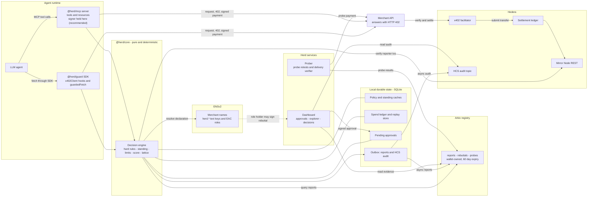
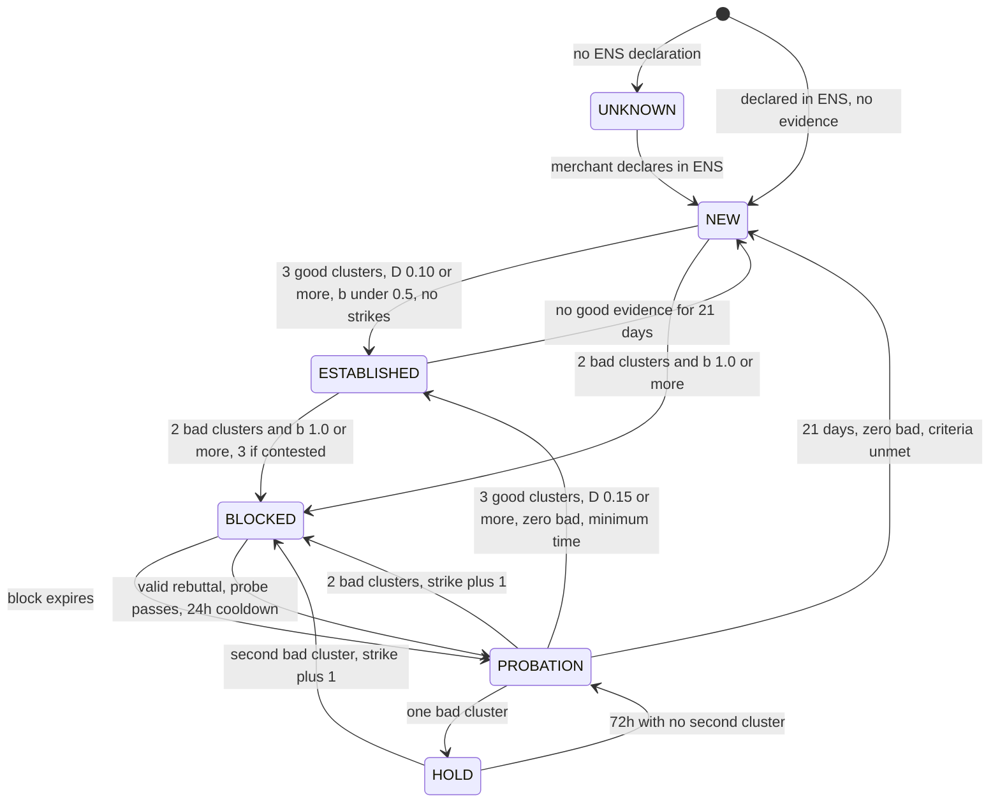
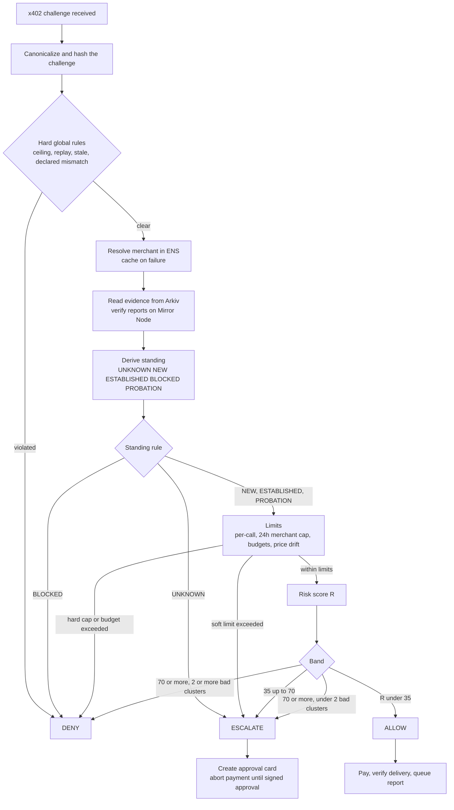
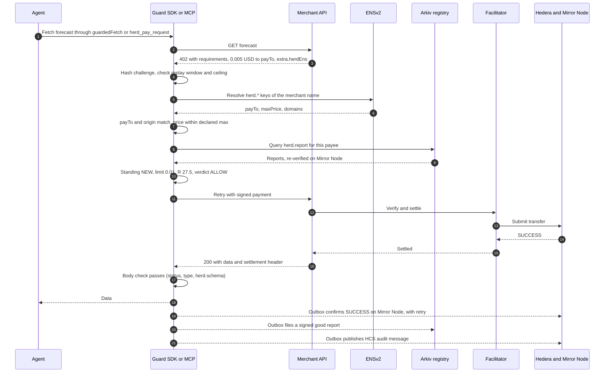

# Herd Immunity — PRD v2.1 (production spec)

Nov 5, 2026 ·

Herd Immunity v2.1 corrects v2.0 after a line-by-line review against the sponsor rules, the SDK source and live testnet APIs, fixes ENSv2 as the identity track, and requires a fully live demo. It is a shared, proof-of-payment-backed payee-safety registry and guard that lets AI agents paying over x402 get ALLOW, ESCALATE or DENY from a multi-factor risk score, with probation, spend caps, replay protection and outage handling, delivered through an SDK and an MCP server.

## Document control and what changed from v1

| Field | Value |
| --- | --- |
| Product | Herd Immunity: shared payee-safety registry and guard for x402 agents |
| Version | 2.1, final for build; supersedes v2.0 |
| Date | 2026-11-05 |
| Owner | Ambuj |
| Event | ETHGlobal Mumbai 2026. Hacking starts Nov 5, 1 pm IST (confirmed by the team). Software only, built from scratch in 36 hours |
| Audience | Claude Code (builder), judges, teammates |
| Companion | None in the repo. The Python reference model behind section 17 is not available here, so its results are labelled as prior results |

This document keeps v1's order (problem, solution, stack, partner tracks, architecture, happy path, failure paths, phases) and adds what a production spec needs: numbered requirements, interface and configuration reference, security model, observability and operations, test and acceptance criteria, and a glossary.

### What v1 lacked and where v2 fixes it

| # | Gap in v1, or change you requested | v2 resolution | Section |
| --- | --- | --- | --- |
| 1 | One integration path | SDK `@herd/guard` and MCP server `@herd/mcp` over one pure engine | 6, 7 |
| 2 | Single-factor net score | Five-factor risk score: money at risk, bad reports, good reports, money lost, money saved (verified delivered value). ALLOW below 35, ESCALATE 35 to 70, DENY at 70 or above, merged with hard rules | 9, 11 |
| 3 | Expiry only, no rebuttal | Signed rebuttal that triggers a probe retest; both bad and good reports expire, so no merchant is blocked forever | 10 |
| 4 | Block cleared straight to full trust (scam loop) | **Probation** after every block: capped payments, human approval above the limit, enhanced monitoring, mandatory delivery verification, good reports required to recover | 10 |
| 5 | No per-merchant cap | Rolling 24-hour cap per agent per merchant, soft then hard | 11 |
| 6 | Unknown merchants could be micro-approved | Unknown (no ENS declaration) always ESCALATE | 11 |
| 7 | No replay window | 120-second window on a challenge hash, single-use approvals | 11 |
| 8 | Outages degraded to ALLOW | Per-dependency fallback matrix, outbox, safe mode; outages degrade to ESCALATE | 12 |
| 9 | Competitor bad reports not handled | Proof of payment, cluster collapse, corroboration, rate limits, rebuttal | 13 |
| 10 | F1 to F10 | All reworked; F11 to F15 added | 15 |
| 11 | No operations, security or acceptance sections | Added | 3, 13, 16, 18 |

**Where probation lives:** section 10, with its limits in the standing table and the recovery rules under "Probation rules".

### Assumptions to confirm

- "Money saved via good reporting" is read as verified delivered value D. Prevented loss is unverifiable and gameable, so it is a dashboard metric only.
- Weights, half-lives and caps are an initial calibration; safety lives in hard rules and limits, not weights.
- Mermaid diagrams are valid text but could not be render-checked in this editor.
- Confirmed by the team on 2026-11-05: the `live` policy profile (1 policy day = 18 real seconds) is used for the demo.
- Confirmed by the team on 2026-11-05: "live" means real keys and real transactions on public testnets with test tokens, not mainnet money (section 16).

### What changed from v2.0 to v2.1

| # | Defect in v2.0 | Fix in v2.1 | Section |
| --- | --- | --- | --- |
| 1 | Standing read as a snapshot: two 0.005 USD reports give b = 1.10, which falls under 1.0 after 9.9 hours, so a block could dissolve early | Standing is a replay of evidence in consensus order; a block latches when it triggers | 10 |
| 2 | Wallets under 24 hours weigh 0.5, so two new wallets reach only b = 0.55 and cannot block; faucet-funded wallets collapse into one cluster | Wallets created at hour 0 from separate funders; first funder read with a bounded Mirror query | 9, 19, 20 |
| 3 | Demo clock moved `now` but not evidence, so reports filed "in probation" landed before the block ended. It was also a simulation | Demo clock removed. A disclosed live policy profile shortens durations; all time is real | 10, 19 |
| 4 | Reports could be forged: nothing tied the Arkiv wallet to the Hedera payer, and the transaction id belongs to the facilitator | Report carries the real payer and a signature from the payer's Hedera key; one report per txId; USDC only | 8, 9, 13 |
| 5 | The score could break the invariant: one cluster with b = 1 and L = 0.5 gives R = 79.6, a DENY | A `risk-band` DENY needs at least two bad clusters; otherwise it is ESCALATE. New fixture S15 | 9, 11 |
| 6 | Probation claims were wrong: a merchant just out of a block has R = 47 at 0.03 USD, not ALLOW. Pre-block evidence could also push R higher | Probation scores only evidence since entry. New fixtures S13, S14. Worked path and demo corrected | 9, 15, 19 |
| 7 | A 200 response with well-formed junk passed the delivery check, and no ENS key declared a schema | New `herd.schema` key with required JSON fields | 8, 10 |
| 8 | No way to get from a 402 to an ENS name | Merchant claims a name in `extra.herdEns`; the claim is verified against ENS | 8, 11 |
| 9 | The x402 hook cannot see the request URL, and `resource.url` is merchant-supplied | `guardedFetch` passes the real URL to the gate | 7 |
| 10 | Facilitator failover was placed in the guard, but the merchant picks the facilitator and `feePayer` is inside the signed transaction | Failover moved to merchants; the guard only prevents double payment | 12 |
| 11 | A "manager role" and per-name role scoping were assumed; ENS docs show neither | One resolver per merchant; the rebuttal right is `ROLE_SET_TEXT` on the `herd.rebuttal` key | 8, 10 |
| 12 | Arkiv API and sort assumptions were out of date | SDK 1.0.1 on `rabdi`; indexed `consensusTs` for newest-first | 4, 8 |
| 13 | Requirements of the sponsors were missed: 5-minute limit, live link, license, AI disclosure, runnable query, written disclosure of pre-existing work | Added to the demo and checklist | 19, 21 |
| 14 | Mocks were allowed in the demo by omission | No-mock rule, FR-25 and FR-26 | 3, 19 |
| 15 | 40-hour plan with 8 packages | 36-hour plan with 5 packages and earlier cuts | 4, 20 |

## 1. Problem

An x402 agent pays any amount a server declares, up to its spend cap, with no human in the loop. That makes the payee the attack surface, and today every defence is local.

- **Declared price is a ceiling, not a promise.** The official client pays whatever the 402 response asks, up to the cap. A merchant can ask for the cap.
- **Payment is not delivery.** x402 settles on-chain before the merchant proves it will deliver. A lemon merchant keeps the money and returns garbage.
- **Prompt injection reaches the payment decision.** Merchant-controlled text can tell an LLM agent to pay a different address.
- **Learning stays private.** Existing agent firewalls (DoorNo.402, TollWarden, PaySafe) apply local rules or their own scores. A scammer that cheats agent A is fresh to agent B unless a vendor's score happens to catch it, and agent B cannot check the evidence.
- **Reputation scores are not checkable evidence.** AgentRadar x402-trust does score payee wallets, from ERC-8004 reputation. Herd's difference is narrower and stronger: every report is proven by a real payment that any reader can re-verify, it expires, and a recovered merchant goes through probation.
- **A cleared scammer re-enters at full trust.** With short expiry and no memory, a merchant can scam, be blocked, wait out the block and scam again.

**The gap:** a shared, evidence-backed, expiring payee registry with a decision layer that weighs money at risk against what is known, so one agent's loss protects the herd, no verdict is permanent, and a recovered merchant earns trust back through probation rather than being forgiven outright.

### Why this helps, and where it does not

Researched for v2.1. Vendor claims are self-published and unaudited.

**Evidence that the problem is real**

- "Five Attacks on x402" (arXiv 2605.11781) measured discovery manipulation: one crafted server was selected 71.8% of the time, and five Sybil listings reached 60.2%. In a snapshot of 13,760 endpoints, one domain held 77.5% of registrations. Listings alone cannot be trusted.
- The same paper audited three SDKs and four live endpoints and reports 11 vulnerabilities; none of the SDKs bound a payment to a specific resource.
- Recorded Future's 2025 report describes more than 3,600 scam merchant accounts on card rails. This shows the merchant-fraud pattern, not agent payments.

**What is not proven:** we found no documented x402 merchant scam incident and no loss figures. The honest pitch is that this is a control to have before such losses appear, not a response to measured ones.

**Who benefits**

| User | Benefit |
| --- | --- |
| Agent owner | Loss per bad merchant is bounded, and normal payments still need no attention |
| Honest merchant | Delivered value raises its limits at every agent, and a block is always recoverable |
| Ecosystem | Evidence is public, so any guard can read it and no vendor has to be trusted |

**Limits of the value**

- Micropayment losses are small per event. The value grows with price per call, agent count and prompt-injection redirects.
- A payee guard does not stop server-side attacks. Of the paper's five, it partly helps with server selection only. Revert-grant, settlement preemption, server-side replay and cache confusion need merchant or protocol fixes (section 13).
- It needs adoption: the registry is only useful once several guards share it.

## 2. Solution and product design

Herd Immunity sits between an agent and every payment. It **identifies** the payee through ENS, **looks up** proven history in Arkiv, **decides** ALLOW, ESCALATE or DENY, and **learns** by filing a verified report after each paid call.

**Goals:** (1) never auto-pay a merchant other agents proved bad; (2) bound the first victim's loss with small caps on new merchants; (3) explain every decision; (4) never block forever and never re-admit at full trust; (5) work through both an SDK and an MCP server.

**Non-goals:** custody of user funds beyond the optional MCP signer, KYC, an on-chain score contract, hardware, a token, simulated demo data.

### Users and surfaces

| User | What they do | Surface |
| --- | --- | --- |
| Agent developer | Wraps an x402 client in two lines, sets limits | SDK `@herd/guard` |
| LLM-agent user | Adds the MCP server to an MCP client; the agent pays through it | MCP `@herd/mcp` |
| Owner / approver | Approves or rejects escalated payments out of band | Dashboard |
| Merchant | Declares payTo, price ceiling, domains and response schema in ENS; signs a rebuttal if blocked | ENS text keys, Rebuttal desk |
| Reporter | Nobody by hand: the guard files good and bad reports automatically | Automatic |

### The decision ladder

| Verdict | Meaning to the agent | Typical cause |
| --- | --- | --- |
| ALLOW | Pay now | Known merchant, amount within limit, low score |
| ESCALATE | Stop and ask the owner | Unknown merchant, amount above limit, medium score, probation, outage with no cache |
| DENY | Never pay this challenge | Blocked merchant, spoof, replay, over declared price, high score |

Standing ladder: **UNKNOWN** (no ENS declaration, always escalate), **NEW**, **ESTABLISHED**, **BLOCKED**, **PROBATION**. The user-facing ladder is allow, escalate, deny, probation; section 10 defines every transition.

### Approval experience

An escalation never lets the LLM decide. The guard stores a pending approval and the owner approves in the dashboard with a wallet signature bound to that exact challenge.

- The **approval card** shows only structured fields: merchant name and ENS, standing badge, amount in USD, score and top three reason codes, declared versus asked price, remaining 24-hour cap, and a 120-second countdown. Raw merchant text is never rendered.
- Actions: **Approve once** (single-use), **Reject**, **Reject and block locally**.

### Dashboard screens

1. **Approvals inbox:** pending cards, history, rate-limit status.
2. **Merchant explorer:** search by ENS, domain or payTo; standing, factor values, reports with proof links, probation progress, strikes, block end date.
3. **Decision log:** every decision with its explanation and HCS audit link.
4. **Rebuttal desk:** merchant signs a rebuttal, sees probe status and probation progress.
5. **Health and safe mode:** status of ENS, Arkiv, Mirror Node, facilitator, HCS.

The merchant explorer is also published as a public read-only page (section 16).

## 3. Requirements

Priority: **M** must, **S** should, **C** could (cut order in section 20). Each requirement has an acceptance criterion tested in section 18.

### Functional requirements

| ID | Requirement | Pri | Acceptance |
| --- | --- | --- | --- |
| FR-01 | SDK `@herd/guard` hooks the x402 client and wraps fetch | M | A paid call through the SDK is gated by a verdict |
| FR-02 | MCP server `@herd/mcp` exposes pay, check, explain, report, approvals, budget | M | MCP Inspector completes a gated payment |
| FR-03 | Both surfaces call one pure engine | M | Same inputs give the same verdict on both |
| FR-04 | Challenge hash and 120-second replay window; stale-challenge refusal | M | Duplicate inside window is DENY `replay` |
| FR-05 | ENS declaration check from a verified merchant claim (payTo, network, asset, max price, domains) | M | Mismatch is DENY `declared-mismatch`; no claim is UNKNOWN |
| FR-06 | Registry read with proof-of-payment re-verification and payer signature check | M | Report without a Mirror SUCCESS USDC transfer, or not signed by the payer's key, is ignored |
| FR-07 | Automatic good and bad reports after delivery check | M | Report visible in Arkiv within the outbox retry window |
| FR-08 | Five-factor risk score with thresholds 35 and 70 | M | Golden fixtures S1 to S15 match |
| FR-09 | Standing machine: UNKNOWN, NEW, ESTABLISHED, BLOCKED, PROBATION | M | Every transition in section 10 tested |
| FR-10 | Probation with limits, hold, mandatory delivery check, recovery rules | M | Scam-loop scenario ends in strike plus 1 |
| FR-11 | Signed rebuttal that triggers a probe retest, never unblocks alone | M | Failed probe leaves merchant BLOCKED |
| FR-12 | Expiry of good and bad reports (60-day TTL, scoring windows) | M | After 60 quiet days no merchant is BLOCKED |
| FR-13 | Per-merchant 24-hour cap, soft then hard (5x) | M | Soft escalates, hard denies |
| FR-14 | Unknown merchant always ESCALATE; blocked key still DENY | M | Verdict table in section 11 |
| FR-15 | Owner-signed, single-use approvals bound to the challenge | M | Second use refused |
| FR-16 | Outage fallbacks for ENS, Arkiv, Mirror Node, facilitator, HCS | M | Chaos suite matches section 12 |
| FR-17 | Griefing defences G1, G2 (basic), G3, G5 | M | One cluster never causes DENY |
| FR-18 | Funding-cluster detection (G2 full), contested detection (G4), price drift, new-identity budget | S | Property and unit tests |
| FR-19 | HCS audit trail of decisions | S | Denied call has an audit message |
| FR-20 | Safe mode when two critical dependencies fail | S | All payments ESCALATE |
| FR-21 | Dashboard: approvals, explorer, decision log, rebuttal desk, health | M | Demo scenes run end to end |
| FR-22 | `explain(decisionId)` returns factors, limits and reasons | M | Matches the stored decision |
| FR-23 | Signed delivery receipts, family taint, Swarm bonus | C | Only if time remains |
| FR-24 | Delivery check enforces `herd.schema` | M | A 200 response missing required fields is a bad report |
| FR-25 | Live policy profile shortens listed durations with real elapsed time; shown on screen | M | Same engine and fixtures; profile banner visible |
| FR-26 | Demo uses no mocks: real wallets, payments, contracts, entities and servers | M | Every demo event has a public explorer link or live query |

### Non-functional requirements

Targets are initial and measured in hours 24 to 30.

| ID | Requirement | Target |
| --- | --- | --- |
| NFR-01 | Added decision latency | p95 under 800 ms with warm caches, under 3 s cold |
| NFR-02 | Determinism | Same evidence and `now` always give the same standing |
| NFR-03 | Fail-safe | No dependency failure produces ALLOW where full information would produce ESCALATE or DENY |
| NFR-04 | Durability | Replay table, ledger, approvals and outbox survive a restart; report delivery is at-least-once and idempotent |
| NFR-05 | Security | The LLM cannot approve; no raw merchant text in tool results or cards; keys never logged |
| NFR-06 | Privacy | Reports carry payee, tx id, amount and reason only; no request or response bodies |
| NFR-07 | Observability | Every decision stored with reason codes and factors; health visible per dependency |
| NFR-08 | Cost | One registry write per paid call; probe spend at most 0.50 USD a day by default |
| NFR-09 | Portability | Node 22.13 or later on Linux, macOS and Windows |
| NFR-10 | Testability | `core` has no I/O and takes `now`; every rule has a unit test |
| NFR-11 | Live only | Test doubles exist only under vitest and cannot be selected by any runtime configuration |

## 4. Tech stack and repo layout

| Layer | Choice | Note |
| --- | --- | --- |
| Language | TypeScript (strict), Node 22+ | Arkiv SDK needs Node 22+ |
| Monorepo | pnpm workspaces | One install, shared types |
| Payments | `@x402/core`, `@x402/fetch`, `@x402/hedera` 2.30 | Hooks: `onBeforePaymentCreation` returns `{abort: true, reason}`; `onAfterPaymentCreation`. Hook context has no request URL |
| Merchants | `@x402/next` or `@x402/hono` (the hour-0 spike picks one) | Real public HTTPS origins |
| Chain access | Hedera primitives re-exported by `@x402/hedera`; Mirror Node REST `https://testnet.mirrornode.hedera.com` | Importing `@hiero-ledger/sdk` separately can create duplicate installs. Verify with `GET /api/v1/transactions/{id}` |
| Facilitator | Blocky402 (`https://api.testnet.blocky402.com`), primary; `https://x402.org/facilitator`, second | Both advertise `hedera:testnet`, with different `feePayer` accounts. Hedera's docs list Blocky402 |
| Registry | `@arkiv-network/sdk` 1.0.1 and `viem` | Chain `rabdi` (id 7794095). `defineSchema`, `createEntity` with `expiration: ExpirationTime.fromSeconds()`, `select().from().where().orderBy().fetch()`. Needs an access key and tGLM |
| Identity | ENSv2 on Sepolia via viem 2.35 or later | Registry, resolver and factory addresses in section 22 |
| MCP | `@modelcontextprotocol/sdk` | stdio |
| Local state | `node:sqlite` | Built in, no native build on Windows. Experimental in Node 22; swap for `better-sqlite3` only if it fails |
| Dashboard | Next.js (App Router), viem for signatures | Owner console runs locally; read-only explorer is public on Vercel |
| Tests | vitest, fast-check | Golden fixtures from section 9 |

Facts that v2.0 left open are now settled in section 22. Each is still confirmed by an hour-0 spike before use.

### Repo layout

```text
herd/
  packages/
    core/        # pure: types, scoring, standing replay, limits, replay window, decision lattice. No I/O.
    guard/       # @herd/guard: SDK plus adapters (arkiv ens mirror hcs) and the sqlite store
    mcp/         # @herd/mcp: MCP server, stdio
  apps/
    dashboard/   # owner console and public read-only explorer
    demo/        # real merchants (weather, lemon, spoof, rogue), prober, agent scripts
  arkiv/         # schema.md friction.md reach.md why-arkiv.md how-you-use-arkiv.md
  LICENSE
  README.md
```

`packages/core` imports nothing from `guard`, takes `now` as an argument, and is the only place decisions are computed. The SDK and the MCP server never re-implement a rule.

## 5. Partner tracks, prizes and stacks

Three tracks, one per partner, all software. Prize details were read from the ETHGlobal Mumbai prize page on 2026-11-05.

| Partner track | Pool and split | Stack we use | How Herd depends on it | What judges must see |
| --- | --- | --- | --- | --- |
| **Hedera: AI Agents That Pay** | $6,500 (3,000 / 2,000 / 1,500) | `@x402/hedera` ExactHederaScheme, a listed facilitator, Mirror Node REST, HCS topic | Real settlement on `hedera:testnet`; Mirror Node proves each report; HCS carries the audit trail | An x402 endpoint, an agent completing a paid request with no human approval, a settled transaction id in the README, HashScan link in a demo of 5 minutes or less. Spending controls and an HCS audit log earn extra points |
| **Arkiv: Build on Arkiv (from scratch)** | $4,000 (3,000 / 1,000) | `@arkiv-network/sdk` | The registry: data lives there and every decision reads it. Expiry is the forgiveness mechanism | Equal judging on friction, reach, why Arkiv and how you use Arkiv. Needs `schema.md`, an open-source license, an AI-use disclosure, writer wallets and one runnable query |
| **ENS: Best Use of ENSv2** | $7,000 (3,000 / 2,000 / 1,000 / 1,000) | Permissioned Registry, Permissioned Resolver, Enhanced Access Control | Identity and policy layer: merchants declare `herd.*` keys; key-scoped roles decide who edits payTo or files a rebuttal | ENSv2 central and not cosmetic, a functional demo that is not hard-coded, a live demo link and open-source code. Agent namespaces are encouraged |
| *Optional* | $500 | Arkiv plus Swarm | Evidence blobs in Swarm, referenced from Arkiv | Only if all Must and Should items are done |

**Why these three together:** each is load-bearing. Without Hedera nothing is paid or proven; without Arkiv there is no shared, expiring memory; without ENS every payee is unknown, which forces an escalation on every payment.

### Decision: ENSv2, not World ID Agent Pass

Arkiv's prize text refers to "your three picks", so we plan on three partners. Hedera and Arkiv are structural, which leaves one slot.

| Question | ENSv2 | World ID Agent Pass |
| --- | --- | --- |
| Prize | $7,000, four winners | $5,000, three winners. The $2,500 version is Continuity only |
| Job in Herd | Says who a payee is and which address it pays to | Confirms a human at the moment of approval |
| Fails without it | F1 spoof, F3 declared price, F5 unknown merchant, rebuttal signer | Nothing: the owner's wallet signature already gates approvals |
| Readable by other guards | Yes, public records | No. It is an OIDC login: tokens are checked against the app's own client id, and no claim binds a payTo address |
| No-mock rule | Real ENSv2 contracts on Sepolia | **Conflict:** the prize page says "Proofs are using fake identities" |
| Extra build | Register names, deploy resolvers, set roles | HTTPS callback, confidential client, backend validation, plus a replacement for merchant identity |
| Sponsor fit | Enhanced Access Control and resolvers are core to the design | Strong fit for ESCALATE: the "human checkpoint" matches our approval card |

**Result: use ENSv2.** The two are not substitutes. Dropping ENS removes the payee identity layer, and Agent Pass cannot replace it, while dropping Agent Pass costs nothing the guard needs. Its fit with approvals is real, so it is the natural later upgrade to the owner signature, once it runs on real identities.

`@worldcoin/agentkit`, a different World product, extends x402 and could weight reporters by unique human. It accepts payments on World Chain and Base rather than Hedera, so it is future work.

**Rules respected:** built from scratch during the event, with history showing the build (ETHGlobal treats single large commits as unqualified); this PRD is disclosed in writing as pre-existing planning material; no Continuity-only prizes claimed; ENS text keys are our own proposal (ENSIP-25 and ENSIP-26 agent records exist but are not used).

## 6. System architecture

The guard sits in the payment path of the agent. All decisions come from one pure engine; the shells (SDK, MCP) gather inputs and carry out the verdict.



### Component duties

| Component | Owns | Never does |
| --- | --- | --- |
| `@herd/core` | Scoring, standing machine, limits, caps, replay rules, decision lattice, reason codes | I/O, clocks (takes `now`), network |
| `@herd/guard` | x402 hook wiring, `guardedFetch`, delivery check, auto-reporting; adapters for ENS, Arkiv, Mirror, HCS; durable local state and outbox | Decide anything, approve an escalation, or block a response on a remote write |
| `@herd/mcp` | MCP tools and resources; holds the payment signer in custody mode | Let the LLM approve, or return raw merchant text |
| Dashboard | Approval signing, explorer, rebuttal desk, health | Compute a decision |
| Prober | Paid probe retests, delivery verification of blocked and probation merchants | Spend above the probe budget |

### Trust boundaries

- **Untrusted:** the LLM, merchant responses, every Arkiv entity until a reader re-verifies it against Mirror Node.
- **Trusted:** ENS records for declarations, Mirror Node for payment facts, the owner's approval signature.
- **Deterministic by design:** standing is a pure replay of (valid reports, probes, rebuttals) in consensus order up to `now`. Any two guards that read the same evidence reach the same standing, so there is no authoritative server to attack or run.

## 7. Interfaces

Both surfaces call the same `decide()` in `@herd/core`. They differ in who holds the signer and how an escalation is waited on.

|  | SDK `@herd/guard` | MCP `@herd/mcp` |
| --- | --- | --- |
| For | Code agents using `@x402/fetch` | LLM-driven agents in any MCP client |
| Signer | Developer's process | MCP server (recommended custody mode) |
| Escalation | `guardedFetch` rejects with `HerdEscalated` plus an approval id, or waits if `awaitApprovalMs` is set | Tool returns `pending_approval`; the LLM may only poll |
| Bypass risk | A developer can call the raw client. Documented, not prevented | The LLM has no path to pay except through the server |

### SDK

```ts
import { x402Client } from "@x402/core/client";
import { wrapFetchWithPayment } from "@x402/fetch";
import { createHerdGuard } from "@herd/guard";

const guard = createHerdGuard({
  network: "hedera:testnet",
  owner: { address: process.env.HERD_OWNER_ADDRESS! },
  limits: { perCallCeiling: 1.00, sessionBudget: 2.00, dailyBudget: 10.00, newIdentityDailyBudget: 0.10 },
  unknownMerchantPolicy: "escalate",
  replayWindowSec: 120,
  autoReport: true,
  mode: "enforce",            // "observe" logs without blocking
  policyProfile: "production", // "live" shortens listed durations, section 10
  namespace: "mumbai",         // separates registry runs
});

const client = new x402Client();
guard.attach(client);        // onBeforePaymentCreation and onAfterPaymentCreation
const paidFetch = guard.guardedFetch(wrapFetchWithPayment(fetch, client));

const d = await guard.check({ url, requirements });   // dry run
const why = await guard.explain(d.id);
```

The x402 hook context carries the 402 and the selected requirements but not the request URL, and `resource.url` is merchant-supplied. So `guardedFetch` holds the real URL in `AsyncLocalStorage` for the hook, and origin checks use only that. A call that reaches the hook outside `guardedFetch` has no known origin and is ESCALATE.

`attach` aborts with `{abort: true, reason: "herd:<verdict>:<codes>"}` unless the verdict is ALLOW, or ESCALATE with a valid, unused approval bound to the challenge hash. `onAfterPaymentCreation` records the spend; `guardedFetch` then runs the delivery check and queues the report.

```ts
type Decision = {
  id: string;
  verdict: "ALLOW" | "ESCALATE" | "DENY";
  reasons: ReasonCode[];            // all that fired, most restrictive first
  standing: "UNKNOWN" | "NEW" | "ESTABLISHED" | "BLOCKED" | "PROBATION";
  score: number;                    // R, 0 to 100
  factors: { bad: number; loss: number; trust: number; exposure: number; identity: number };
  limits: { autoApprove: number; cap24h: number; capUsed24h: number };
  challengeHash: string;
  approvalId?: string;              // set when ESCALATE
  degraded?: { dependency: string; staleSec: number };
};
```

### MCP tools and resources

| Tool | Input | Output | Notes |
| --- | --- | --- | --- |
| `herd_pay_request` | `url`, `method`, `maxUsd`, `idempotencyKey?` | `paid` with body and tx id, `pending_approval`, or `denied` with reason codes | Server holds the signer; full pipeline |
| `herd_check_merchant` | `key` (ENS, domain or payTo) | Standing, factors, strikes, block end, rebuttal enum | Read-only |
| `herd_explain_decision` | `decisionId` | Reasons, factors, limits, timestamps | Read-only |
| `herd_report_outcome` | `txId`, `outcome`, `note?` | Report status | Only for payments this server made |
| `herd_list_pending_approvals` | none | Pending cards (structured fields only) | Read-only |
| `herd_await_approval` | `approvalId`, `timeoutMs` | `approved`, `rejected`, `expired`, `still_pending` | Polls only; cannot approve |
| `herd_get_budget` | none | Session, daily and per-merchant remaining | Read-only |

Transport: stdio. MCP resources and streamable HTTP are cut for the event; the tools cover the same reads.

**Injection hardening:** every tool result is built from structured fields (enums, numbers, ids, ENS names validated against a name grammar). Raw merchant text, headers and bodies are never placed in a result except as an opaque, length-capped `body` field of a successfully paid call, flagged `untrusted: true`. **There is no approve tool:** approval is an owner-key signature produced in the dashboard, bound to `challengeHash`, valid 120 seconds, once.

### Configuration reference

| Key | Default | Meaning |
| --- | --- | --- |
| `policyProfile` | `production` | `live` shortens the durations listed in section 10 |
| `namespace` | required | Registry namespace attribute; a new value starts a clean run |
| `limits.perCallCeiling` | 1.00 USD | DENY above this |
| `limits.sessionBudget` / `dailyBudget` | 2.00 / 10.00 USD | DENY when exceeded |
| `limits.newIdentityDailyBudget` | 0.10 USD | ESCALATE when exceeded |
| `unknownMerchantPolicy` | `escalate` | Fixed in v2 |
| `replayWindowSec` | 120 | Replay window and approval lifetime |
| `escalationRatePerHour` | 10 | DENY `escalation-rate-limit` beyond this |
| `thresholds.allow` / `deny` | 35 / 70 | Score bands |
| `probe.budgetPerDay` | 0.50 USD | Prober spend cap, 0.01 USD per probe |
| `cache.ensFreshSec` / `ensStaleSec` | 60 / 600 | ENS staleness limits |
| `cache.standingFreshSec` / `standingStaleSec` | 60 / 900 | Standing staleness limits |
| `mode` | `enforce` | `observe` logs without blocking |

## 8. Data model

ENS holds declarations, Arkiv holds expiring shared evidence, Hedera holds payment facts and an audit trail. A local SQLite store keeps everything that must survive a restart.

### ENS text keys (project-proposed)

| Key | Value | Purpose |
| --- | --- | --- |
| `herd.payTo` | Hedera account id or EVM address | The only address the merchant will ask payment to |
| `herd.network` | `hedera:testnet` | Network accepted |
| `herd.asset` | Token id | Asset accepted |
| `herd.maxPrice` | USD per call | Declared ceiling; asking more is DENY |
| `herd.domains` | Comma-separated origins | Origins allowed to serve 402s |
| `herd.schema` | Comma-separated required JSON fields | Checked on every delivery. With no schema, the check can only see status, type and empty bodies |
| `herd.probeUrl` | URL | Resource the prober may buy for retests |
| `herd.rebuttal` | Latest rebuttal entity key | Written only by the role holder; holding this right is what authorises a rebuttal |
| `herd.policyVersion` | Integer | Bumped on any change; guards invalidate caches |

**Resolvers and roles:** each merchant gets its own Permissioned Resolver, deployed through the Verifiable Factory, because a resolver role covers every name that instance serves. Roles can be scoped to one text key with `grantSetterRoles`, so a delegate can edit `herd.domains` without changing `herd.payTo`. A rebuttal is valid only from a wallet holding `ROLE_SET_TEXT` on the `herd.rebuttal` key (read path confirmed in the hour-0 spike; if no read exists, the signer must prove it with a live `setText`).

**Merchant claim:** a merchant names itself in the 402 as `extra.herdEns`. The claim is never trusted alone: the guard resolves the name, then checks origin and payTo against it. A merchant can omit the claim, but that makes it UNKNOWN, which always escalates.

### Arkiv entities

All are wallet-owned. Readers re-verify before trusting; an entity is data, never a verdict.

| Entity | Key attributes | Written by | Expiry |
| --- | --- | --- | --- |
| `herd.report` | `ns`, `payee`, `domain`, `ens`, `outcome` (good or bad), `txId`, `payer`, `payerSig`, `consensusTs`, `amountMicroUsd`, `reason`, `v` | The paying guard, automatically | 60 days |
| `herd.rebuttal` | `ns`, `payee`, `ens`, `reason` (enum), `evidenceHash`, `episodeStart` | Role holder of the ENS name | 30 days |
| `herd.probe` | `ns`, `payee`, `result` (pass or fail), `txId`, `consensusTs`, `deliveryDigest` | Allow-listed prober wallets | 60 days |

Query: `from(Report).where(and(eq("ns", N), eq("payee", X))).orderBy(desc("consensusTs")).limit(200)`. Arkiv cannot sort by `$createdAt`, so `consensusTs` is an indexed column; readers replace it with the value from Mirror Node and drop any mismatch. Age is the Hedera **consensus timestamp** of `txId`, never the entity's `createdAt`. Both outcomes carry the same 60-day expiry, so strike memory lasts as long as good history.

### Hedera

- **Mirror Node:** `GET /api/v1/transactions/{id}` confirms SUCCESS, payee and amount for every report. The id in `0.0.x@s.n` form converts to `0.0.x-s-n`. **The account in the transaction id is the facilitator**; the real payer is the account with the negative transfer of the asset in `token_transfers` (confirmed on a live testnet payment).
- **HCS audit topic:** JSON messages of type `decision`, `report`, `rebuttal`, `probe`, `approval`. Pre-payment DENYs go here only, since there is no payment proof to file in Arkiv.

### Local SQLite tables

| Table | Holds |
| --- | --- |
| `decisions` | Every decision with factors and reasons |
| `challenges` | `challengeHash`, first-seen and paid times (replay window) |
| `spend_ledger` | Per agent, per merchant, rolling 24 hours, per session |
| `approvals` | Pending, used, expired; bound to `challengeHash` |
| `outbox` | Reports and HCS messages awaiting retry |
| `cache_policy` | ENS declarations with fetch time |
| `cache_standing` | Computed standing with evidence timestamp |
| `probe_budget` | Prober spend per day |

## 9. Risk scoring model

Every payment gets a risk score R from 0 to 100 built from five factors. **ALLOW below 35, ESCALATE from 35 to below 70, DENY at 70 or above.** The score grades a payment; hard rules and limits in section 11 still apply, and the most restrictive result wins.

### The factors

| Factor you specified | Symbol | Term | Weight |
| --- | --- | --- | --- |
| Number of bad reports | b | f\_bad | 0.30 |
| Money previously lost to this merchant | L | f\_loss | 0.20 |
| Number of good reports | g | f\_trust | 0.15 |
| Money at risk in this payment | A | f\_expo | 0.20 |
| Money saved via good reporting (verified delivered value) | D | Lowers f\_loss and f\_expo; sets the ESTABLISHED limit (0.5 x D) | via the terms above |
| Merchant maturity (added: standing, strikes, family taint) | s, t | f\_ident | 0.15 |

```latex
R = 100\,(0.30\,f_{bad} + 0.20\,f_{loss} + 0.15\,f_{trust} + 0.20\,f_{expo} + 0.15\,f_{ident})

f_{bad} = 1 - e^{-b} \qquad f_{loss} = \frac{L}{L + D + 0.05} \qquad f_{trust} = e^{-g/2}

f_{expo} = \min\!\left(1, \frac{A}{D + 0.02}\right) \qquad f_{ident} = \min\!\left(1,\; base + 0.1\,\min(s,3) + 0.2\,t\right)
```

`base` is 0.5 for NEW, 0 for ESTABLISHED, 0.7 for PROBATION. `s` is the strike count; `t` is 1 if two or more sibling names under the same parent ENS name are BLOCKED. A is the USD amount of this payment.

### Evidence rules

1. **Valid reports only:** Mirror Node shows the tx SUCCESS, it moved the **declared USDC token** (0.0.429274 on testnet) from `payer` to this payee, amount at least the stated amount, and `payerSig` verifies against that payer's ED25519 or ECDSA key from `GET /accounts/{payer}`. The signed message is `herd.report:v1|ns|txId|payee|outcome|amountMicroUsd|arkivOwner`. Accounts with complex keys are ignored. One report counts per txId; if the payer signed conflicting outcomes for one txId, neither counts.
2. **Cluster collapse:** reports group by the payer's funding cluster: the account that funded its creation, read from `/transactions?account.id=X&timestamp=gte:<created>&order=asc&limit=1` because an unbounded query can return an empty page. Known public faucets do not form a cluster, so those wallets stand alone at age weight. A cluster counts once per side. Accounts under 24 hours old weigh 0.5.
3. **Value factor:** v(a) = 0.5 + 0.5 x min(1, a / 0.05 USD), so a dust report weighs half a real one.
4. **Decay and windows:** bad evidence has a 72-hour half-life inside a 7-day window; good evidence a 168-hour half-life inside a 21-day window. Age uses the consensus timestamp.
5. **Money terms:** L and D are decayed sums per cluster, each cluster capped at 0.50 USD.
6. **Retention:** both outcomes live 60 days in Arkiv (strike memory); only the windows above feed the score.
7. **Probation scope:** in PROBATION, b, L, D and g use only evidence after probation began, matching S8 and S9. A merchant is not punished twice for the block it just served.

b and g are the cluster-weighted, decayed sums of v(a).

### Golden examples

The fixtures `packages/core` must reproduce exactly. Limits are the per-call auto-approve limits from section 10.

| Case | Standing | b | L | D | g | A (USD) | R | Band | Auto limit | Final |
| --- | --- | --- | --- | --- | --- | --- | --- | --- | --- | --- |
| S1 Established, clean | ESTABLISHED | 0 | 0 | 0.60 | 4 | 0.05 | 3.6 | ALLOW | 0.30 | **ALLOW** |
| S2 New, declared, tiny | NEW | 0 | 0 | 0 | 0 | 0.005 | 27.5 | ALLOW | 0.01 | **ALLOW** |
| S3 New, asks 0.05 | NEW | 0 | 0 | 0 | 0 | 0.05 | 42.5 | ESCALATE | 0.01 | **ESCALATE** |
| S4 New plus one bad cluster | NEW | 0.55 | 0.005 | 0 | 0 | 0.005 | 42.0 | ESCALATE | 0.01 | **ESCALATE** |
| S5 New plus two bad clusters | NEW | 1.10 | 0.01 | 0 | 0 | 0.005 | 50.8 | ESCALATE | 0.01 | **DENY** (standing BLOCKED) |
| S6 Established, one bad vs strong good | ESTABLISHED | 0.80 | 0.05 | 0.60 | 4 | 0.05 | 21.6 | ALLOW | 0.30 | **ALLOW** |
| S7 Established, big buy | ESTABLISHED | 0 | 0 | 0.10 | 3 | 0.90 | 23.3 | ALLOW | 0.05 | **ESCALATE** (limit) |
| S8 Probation, strike 1 | PROBATION | 0 | 0 | 0.05 | 1 | 0.03 | 29.7 | ALLOW | 0.05 | **ALLOW** |
| S9 Probation, recovering | PROBATION | 0 | 0 | 0.20 | 3 | 0.03 | 18.1 | ALLOW | 0.05 | **ALLOW** |
| S10 Probation, strike 3, tainted | PROBATION | 0 | 0 | 0 | 0 | 0.50 | 50.0 | ESCALATE | 0.017 | **ESCALATE** |
| S11 Established | ESTABLISHED | 0 | 0 | 0.60 | 4 | 0.10 | 5.3 | ALLOW | 0.30 | **ALLOW** |
| S12 Established, large | ESTABLISHED | 0 | 0 | 0.60 | 4 | 0.40 | 14.9 | ALLOW | 0.30 | **ESCALATE** (limit) |
| S13 Probation entry, strike 1, tiny | PROBATION | 0 | 0 | 0 | 0 | 0.005 | 32.0 | ALLOW | 0.05 | **ALLOW** |
| S14 Probation entry, strike 1, 0.03 | PROBATION | 0 | 0 | 0 | 0 | 0.03 | 47.0 | ESCALATE | 0.05 | **ESCALATE** |
| S15 New, one bad cluster, b 1, L 0.50 | NEW | 1 | 0.50 | 0 | 0 | 0.05 | 79.6 | DENY | 0.01 | **ESCALATE** (one-cluster clamp) |

- **One bad report flips a new merchant** from ALLOW (S2) to ESCALATE (S4). Two independent clusters block it (S5), a standing rule rather than a score band.
- **A lone report does not flip a contested established merchant** (S6).
- **For a new merchant the band already forbids amounts above about 0.0125 USD**, so the NEW limit is 0.01; a larger limit would never bind.
- **One cluster can reach the DENY band** (S15). The engine clamps this: `risk-band` is DENY only with at least two distinct bad clusters, otherwise ESCALATE. This is what makes the section 13 invariant true.
- **A merchant fresh out of a block cannot auto-pay much** (S13, S14): the band allows about 0.008 USD until it builds delivered value. Its 0.05 limit binds only after that (S8).
- Safety comes from standing and limits, so weights can be retuned without weakening it.

### Calibration

Property test: raising b, L or A never lowers R; raising g or D never raises R. Golden fixtures must pass byte for byte. All 15 were recomputed from the formula for v2.1; published values are rounded to one decimal.

## 10. Standing, probation, rebuttal and recovery

A merchant is never blocked forever and never cleared straight to full trust. **A block always ends in probation, and only proven deliveries during probation restore ESTABLISHED.**



**Standing is a replay, not a snapshot.** The engine folds all evidence in consensus order and evaluates each transition at the moment of that event. A block latches at the consensus time of the report that triggered it and runs its full duration, even after b decays below 1.0.

The ladder the user sees (allow, escalate, deny, probation) maps onto this machine: UNKNOWN always escalates, BLOCKED always denies, PROBATION constrains every verdict, and NEW or ESTABLISHED are graded by score and limits.

### Standing limits

| Standing | Auto-approve per call | 24h cap per agent per merchant (soft, then escalates) | Hard cap (denies) | Anything above |
| --- | --- | --- | --- | --- |
| UNKNOWN | none | none | none | **Always ESCALATE** |
| NEW | 0.01 USD | 0.05 | 0.25 | ESCALATE |
| ESTABLISHED | max(0.01, min(declared max, 1.00, 0.5 x D)) | 1.00 | 5.00 | ESCALATE |
| PROBATION | max(0.01, 0.05 / strikes), and the score band still applies (S13, S14) | 0.10 | 0.50 | ESCALATE |
| BLOCKED | none | none | none | **DENY** |

### Transitions

| Move | Trigger | Rule |
| --- | --- | --- |
| NEW or ESTABLISHED to BLOCKED | At least 2 distinct bad clusters in 7 days and b at least 1.0 | A contested ESTABLISHED merchant (g at least 3 and D at least 5 x L) needs 3 clusters. **Invariant: one reporter cluster alone can never cause DENY** |
| BLOCKED duration | Strikes s = block episodes in the last 60 days | min(5 days x 2^(s-1), 20 days): 5, 10, then 20 days |
| BLOCKED to PROBATION | Natural expiry, or early via rebuttal plus probe | Never directly to ESTABLISHED |
| PROBATION to ESTABLISHED | 3 good clusters (prober counts as at most one), D during probation at least 0.15, zero bad, at least 3 days x min(s, 3) | Evidence from before probation does not count |
| PROBATION to NEW | 21 days with zero bad reports but criteria unmet | Strikes kept, so ESTABLISHED stays out of reach until they expire |
| PROBATION hold | One bad cluster during probation | Every payment ESCALATES for 72 hours (`probation-hold`) |
| PROBATION to BLOCKED | Two bad clusters during probation | Strike plus 1, so the next block is longer |
| NEW to ESTABLISHED | 3 good clusters, D at least 0.10, b under 0.5, first good report at least 24 hours old, no strikes | Fast reports do not promote instantly |
| ESTABLISHED to NEW | No valid good evidence in the 21-day window and no bad evidence | Good reports expire too. Not covered by the simulation; add a property test |
| Strike forgetting | 60 days with no block episode | Strikes drop to zero: no permanent block |

### Probation rules

1. **Limited payments only:** the per-call limit and the 0.10 USD daily cap above.
2. **Auto-approval off above the limit:** every larger payment is ESCALATE (`probation-limit`) and needs the owner's signed approval.
3. **Enhanced reputation monitoring:** identity term starts at 0.7; the prober buys one probe a day (at most 0.01 USD) and records the result in Arkiv; any bad cluster triggers the hold.
4. **Mandatory delivery verification on every payment:** settlement SUCCESS on Mirror Node, HTTP 2xx, non-empty body, matching content type, and every field required by `herd.schema`. The same check runs for all merchants; probation adds the probes and hold around it. The guard files the report only after the check; a failed check is a bad report at once.
5. **Good reports required for recovery:** the thresholds in the table above. Waiting alone reaches NEW, never ESTABLISHED.

### Rebuttal versus expiry

|  | Report expiry | Signed rebuttal |
| --- | --- | --- |
| Who acts | Nobody; time passes | The wallet holding `ROLE_SET_TEXT` on the merchant's `herd.rebuttal` key |
| Content | Nothing | Fixed reason (outage, config-error, payment-mismatch, dispute-customer-error, compromised-key-rotated) plus an evidence URL or hash |
| Effect | Block ends on schedule, then PROBATION | Does **not** unblock. It queues a probe retest; if the probe passes and 24 hours have passed since the block began, the merchant moves to PROBATION early |
| Limit | Bad evidence leaves the score after 7 days and the registry after 60 | One rebuttal per block episode; a failed probe stays visible and the merchant waits for expiry |
| Shown to others | Not applicable | Reason enum and filing time only, never free text |

The v1 chicken-and-egg problem (a blocked merchant gets no payments, so it can never earn good reports) is solved by the probe: the prober's own small paid call is the retest, bounded by the probe budget.

### Policy profiles

Fixtures and defaults use `production`. A 5-day block cannot be shown live, and a moved clock would be a simulation, so the `live` profile shortens selected durations to **1 policy day = 18 real seconds**. Nothing is faked: the same engine runs on real consensus timestamps while real time passes. The active profile is on screen at all times and disclosed in `/arkiv/friction.md`.

| Duration | Production | Live |
| --- | --- | --- |
| Block, strikes 1 / 2 / 3 | 5 / 10 / 20 days | 90 s / 180 s / 360 s |
| Probation hold | 72 hours | 54 s |
| Rebuttal cooldown | 24 hours | 18 s |
| Probation minimum time | 3 days x min(s, 3) | 54 s x min(s, 3) |
| Strike memory and Arkiv report expiry | 60 days | 18 minutes |
| Standing cache fresh | 60 s | 5 s |

**Not shortened:** score decay and windows, wallet age weight, replay window, approval lifetime, 24-hour spend caps, budgets. Hedera and Arkiv timestamps are never altered.

## 11. Decision engine

The engine is a fixed pipeline. Every gate can add reason codes; the verdict is the most restrictive gate result (DENY over ESCALATE over ALLOW). It runs before the payment is created, inside `onBeforePaymentCreation` or the MCP `herd_pay_request` tool.



Evidence is read for every payee, including one with no ENS declaration, so a payTo address that other agents proved bad is DENY even without an ENS name.

### Rules and reason codes

| Verdict | Reason code | Fires when |
| --- | --- | --- |
| DENY | `ceiling-exceeded` | Amount above the per-call ceiling (default 1.00 USD) |
| DENY | `declared-mismatch` | The merchant claims an ENS name and payTo, network, asset or real request origin differs from that declaration |
| DENY | `over-declared-max` | Asked price above `herd.maxPrice` |
| DENY | `replay` | Same challenge hash paid within 120 seconds, no idempotency flag |
| DENY | `stale-challenge` | Challenge first seen longer ago than its `maxTimeoutSeconds` |
| DENY | `blocked` | Standing is BLOCKED |
| DENY | `merchant-cap-hard` | 24-hour spend with this merchant would exceed 5 x the soft cap |
| DENY | `budget-exceeded` | Session or daily budget would be exceeded |
| DENY | `escalation-rate-limit` | More than 10 new escalations in an hour |
| DENY | `risk-band` | R at least 70 and at least 2 distinct bad clusters |
| ESCALATE | `unknown-merchant` | No claim, or the claimed name has no declaration (always) |
| ESCALATE | `limit-exceeded` | Amount above the standing's per-call auto limit |
| ESCALATE | `merchant-cap` | 24-hour spend would exceed the soft cap |
| ESCALATE | `new-identity-budget` | Spend on NEW merchants today would exceed 0.10 USD |
| ESCALATE | `price-drift` | Price above 2 x the median of the last 5 paid calls to the same resource |
| ESCALATE | `probation-limit`, `probation-hold` | Section 10 |
| ESCALATE | `risk-band` | R from 35 to below 70, or R at least 70 with fewer than 2 bad clusters |
| ESCALATE | `registry-unavailable`, `declared-stale-mismatch`, `unverified-reports`, `safe-mode` | Section 12 |

### Per-merchant spending cap

A rolling 24-hour ledger per (agent, merchant), keyed by ENS name when declared, otherwise payTo. It counts amounts already paid plus the amount being decided. Above the **soft cap**: ESCALATE `merchant-cap`. Above the **hard cap** (5 x soft): DENY `merchant-cap-hard`, which stops a slow ramp even when each payment looks small. Caps shrink with weaker standing and halve in degraded mode.

### Unknown merchants

Any payee with no ENS declaration is **always ESCALATE**, even for 0.001 USD (`unknownMerchantPolicy: "escalate"`, fixed in v2). The herd lookup still runs, so a blocked key is DENY. After 10 new escalations in an hour the guard denies, which stops approval bombing. A later version may add `allow-micro` once the registry is large enough to trust.

### Replay protection window

1. `challengeHash` = sha256 of the canonical JSON of scheme, network, asset, amount, payTo, normalized resource URL, `maxTimeoutSeconds` and `extra`.
2. The same hash paid within **120 seconds** is DENY `replay`, unless the caller passes an explicit idempotency flag.
3. A challenge first seen longer ago than its `maxTimeoutSeconds` is refused; the agent fetches a fresh 402.
4. An approval is bound to one `challengeHash`, single-use, and expires in 120 seconds.
5. Reports are deduplicated by (reporter, txId).
6. The challenge table is persistent SQLite, so a restart does not reopen the window. Hedera also rejects a duplicate transaction id inside its validity window.

### Global limits

Per-call ceiling 1.00 USD (DENY), session budget 2.00 USD and daily 10.00 USD (DENY), new-identity daily exposure 0.10 USD (ESCALATE). All are configuration defaults; none depends on the score.

## 12. Resilience and outage handling

**Principle: an outage never turns into a silent ALLOW.** The guard degrades toward ESCALATE, keeps honouring cached blocks, and never lets a remote write block the agent.

| Dependency | Detected by | Fallback | Effect on decisions | Recovery |
| --- | --- | --- | --- | --- |
| **ENS** | Resolve timeout or error | Cached declaration: fresh 60 s, usable stale up to 10 min | Stale cache: decision marked `degraded`, caps halved. A stale declaration that mismatches the 402 is ESCALATE `declared-stale-mismatch`, never DENY. No cache: treated as UNKNOWN, so ESCALATE | Refresh on next success; `herd.policyVersion` bump invalidates cache |
| **Arkiv** | Query timeout or error | Cached standing. Stale ESTABLISHED usable up to 15 min with caps halved. Cached BLOCKED or PROBATION honoured until its computed end | No usable cache: ESCALATE `registry-unavailable` | Report writes go to the outbox with backoff; responses never wait on a write |
| **Mirror Node** | Timeout or 5xx | Verdict cache by txId; unverified reports ignored for scoring | Two or more clusters of unverified bad reports: ESCALATE `unverified-reports`, never DENY. If settlement cannot be confirmed, the report is held and retried | Held reports re-verified, then filed |
| **Facilitator** | Health screen polls `GET /supported`; failed settle | The merchant chooses the facilitator and `extra.feePayer` is inside the signed transaction, so **failover is merchant-side** (our merchants fall back from Blocky402 to x402.org). The guard does not switch | After a failed settle, the guard takes the txId from the signed transaction and checks Mirror Node **before** paying again; a new attempt needs a fresh 402. Unknown outcome is ESCALATE | Health check passes again |
| **HCS** | Submit error | Async outbox | None; audit is delayed, never blocking | Retry with backoff |
| **Dashboard** | Not reachable | Approvals stay pending and expire | Fail closed: no approval, no payment | Cards re-created on request |
| **Guard process** | Crash or restart | SQLite persists challenges, ledger, approvals, outbox | Replay window and caps survive restart | Outbox drains on start |

### Safe mode

If two or more of ENS, Arkiv and Mirror Node fail at once, every payment is ESCALATE `safe-mode`, except a payee with a cached BLOCKED standing, which stays DENY. The dashboard health screen shows the cause; the mode ends after three consecutive healthy probes.

### Staleness limits

| Data | Fresh | Usable stale | Beyond |
| --- | --- | --- | --- |
| ENS declaration | 60 seconds | 10 minutes | Treated as UNKNOWN |
| ESTABLISHED standing | 60 seconds | 15 minutes, halved caps | `registry-unavailable` |
| BLOCKED or PROBATION | Until computed end | Until computed end | Re-read on next success |
| Mirror verdict by txId | Permanent | Not applicable | Not applicable |

## 13. Security and abuse resistance

The registry is public and writable by anyone with a wallet, so every input is hostile. Core invariant: **no single reporter cluster can cause DENY, only ESCALATE.** A competitor cannot silence a merchant alone; blocking needs several independently funded clusters, each with a real paid transaction.

### Threat model

| Actor | Goal | Main defences |
| --- | --- | --- |
| Malicious merchant | Take payment without delivering, or redirect payment | Delivery check, caps, ENS declaration match, two-cluster block, probation |
| Prompt injector (merchant text) | Make an LLM pay or approve | Structured fields only, no approve tool, owner-signed approvals |
| Competitor | Smear a good merchant | G1 to G7 below |
| Sybil reporter | Fake good or bad evidence | Proof of payment, funding-cluster collapse, caps on positive evidence |
| Rotating scammer | New identity after each block | NEW caps, shared report keys, budgets; measured residual in section 17 |
| Compromised agent or SDK user | Bypass the guard | MCP custody mode; SDK bypass documented |
| Network attacker | Replay or tamper | Challenge hash window, persistent replay table, signed approvals |

Keys: the owner key never leaves the dashboard; the MCP payment signer is held by the server process; no key is logged or placed in a tool result.

### Bad reports against competitors (griefing)

| # | Defence | What it stops |
| --- | --- | --- |
| G1 | **Proof of payment required:** a report cites a Mirror-verified SUCCESS USDC transfer to this payee and is signed by the paying account's key; one report per txId | Fabricated reports, citing someone else's payment, paying with a worthless token |
| G2 | **Distinct wallets and funding-cluster collapse;** accounts under 24 hours weigh 0.5 | One attacker with many wallets |
| G3 | **Corroboration:** block needs 2 independent bad clusters (3 for a contested ESTABLISHED merchant) | One reporter blocking a merchant |
| G4 | **Contested detection:** g at least 3 and D at least 5 x L halves bad weight | Smears against strong delivery records |
| G5 | **Per-reporter rate limit:** at most 5 bad reports a day, 1 per payee per 24 hours; readers ignore the excess | Report spam |
| G6 | **Concentration monitoring** on the dashboard | Coordinated campaigns (observability) |
| G7 | **Rebuttal and optional signed receipts** (`Herd-Receipt` header; contradicted bad reports weigh about 2.0 for the merchant), a stretch goal | Claims of non-delivery for delivered goods |

An attacker needs at least two separately funded wallets making real paid calls. The defender's cost is an ESCALATE during the attack, then a bounded, recoverable probation rather than a ban.

**Residual risk, stated plainly:** griefing a NEW merchant is cheap. Two 0.005 USD payments from wallets over 24 hours old reach b = 1.10, about 0.01 USD in total, and the facilitator pays the fees. One-hop funding clusters are also easy to evade with an intermediate account. The rebuttal and probe path is the merchant's way out, and ESTABLISHED merchants are harder targets (S6). Raising the cost means retuning weights after real data.

### Protocol attacks outside the guard

The guard covers payee risk. These classes from arXiv 2605.11781 are handled elsewhere:

| Attack | Status |
| --- | --- |
| Revert-grant | Hedera has immediate finality, so reorgs do not apply |
| Settlement preemption | Not stopped. It makes an honest merchant look like non-delivery, so one report never blocks (G3) |
| Server-side replay | Our merchants serve once per transaction. Other merchants are out of scope |
| Proxy or cache confusion | Our merchants send `Cache-Control: no-store`. Other merchants are out of scope |
| Server selection | Partly helped: unknown payees escalate and proven-bad payees are denied |

### Whitewashing

A fresh ENS name starts NEW (0.01 USD per call, 0.05 USD a day). Reports are filed under payTo, domain and ENS name together. Family taint (two or more BLOCKED siblings under one parent name: identity +0.2, NEW cap halved) and a 0.10 USD daily new-identity budget are cheap extra signals. The simulation (section 17) showed taint changed nothing and the budget did not bind, so **they are not relied on**; the real bound is economic, about 0.03 USD per burned identity against a registration cost on mainnet. Residual risk, stated plainly.

### Wash trading

Paying yourself is cheap on Hedera. Positive evidence is capped (0.50 USD per cluster) and weighted by cluster, cannot override a BLOCK, and ESTABLISHED limits scale with D but never exceed the 1.00 USD ceiling. Residual risk: a patient attacker can buy ESTABLISHED standing for the cost of the trades plus fees; World ID uniqueness weighting is future work.

### Approval abuse and bypass

The LLM cannot approve; cards contain structured fields only; approvals are single-use and bound to one challenge; escalations are rate limited. SDK mode cannot stop a developer calling the raw client, so MCP custody mode is recommended.

## 14. Happy path

An agent buys a 0.005 USD forecast from an ENS-declared merchant with no history (standing NEW). The amount is within the NEW limit, the score is 27.5, and the call is allowed, verified and reported.



The agent is not held up by Mirror Node lag or a registry write. A failed settlement check turns the queued report into a held report, never a good one. The registry gains a `herd.report` (outcome good, amount, tx id, payer signature) that expires in 60 days. After the third independent good cluster, delivered value of at least 0.10 USD and a first good report at least 24 hours old, the merchant becomes ESTABLISHED and its limit rises to 0.5 x D. The owner sees nothing: a normal payment needs no interaction, and the decision log shows ALLOW, score 27.5, no reasons.

## 15. Failure paths F1 to F15

F1 to F10 are v1's paths, each reworked. F11 to F15 are new. Every row has a test in section 18.

| ID | Failure | v1 gap | v2 handling | Verdict and reason | Residual risk |
| --- | --- | --- | --- | --- | --- |
| F1 | Spoof or prompt injection: the 402 pays a different address than the ENS declaration, or page text says to pay elsewhere | Trusted merchant-visible data | Compare payTo, network, asset, origin with ENS; structured fields only; pre-payment denials logged to HCS only | DENY `declared-mismatch`; unknown payee ESCALATE | Compromised ENS owner key |
| F2 | Lemon merchant takes payment, returns garbage | Net score ignored money at risk | NEW limit 0.01 and daily cap 0.05 bound the first loss; `herd.schema` check files a bad report at once; two clusters block; then probation | ALLOW for micro, then ESCALATE, then DENY `blocked` | First victims lose up to the NEW cap; plausible junk that fits the schema passes |
| F3 | Price above declared maximum or bait and switch | Max not enforced | Hard rule on `herd.maxPrice`; price above 2 x median of last 5 paid calls escalates | DENY `over-declared-max`; ESCALATE `price-drift` | No declared max |
| F4 | Slow ramp: price creeps up | Per-call view only | 24-hour per-merchant ledger, soft and hard (5 x) cap; price drift; ESTABLISHED limit 0.5 x D | ESCALATE `merchant-cap`; DENY `merchant-cap-hard` | Attacker who builds D first |
| F5 | Unknown merchant, no ENS declaration | Micro-ALLOW in degraded mode | Always ESCALATE; herd lookup still runs; 10 escalations an hour then DENY | ESCALATE `unknown-merchant` | Owner approves anyway |
| F6 | Replay or double payment of one challenge | No window | Challenge hash, 120-second window, stale refusal, single-use approvals, persistent store, report dedupe | DENY `replay`, `stale-challenge` | Deliberate repeat needs the idempotency flag |
| F7 | ENS or Arkiv outage | Degraded to ALLOW | Caches with staleness limits, halved caps, outbox, safe mode | ESCALATE `registry-unavailable`, `safe-mode` | Cache stale 10 to 15 minutes |
| F8 | Griefing: a competitor files bad reports | Any report count could block | Payer-signed proof of payment, cluster collapse, corroboration, one-cluster clamp, contested detection, rate limits, rebuttal | One cluster ESCALATE at most; block needs 2 or 3 clusters | About 0.01 USD can block a NEW merchant from two aged, separately funded wallets |
| F9 | Facilitator or settlement failure mid-payment | Retry could double-pay | After a failed settle, check Mirror by txId before any new attempt; a new attempt needs a fresh 402; failover is merchant-side | No second payment; ESCALATE if unknown | Merchant with no working facilitator |
| F10 | Approval abuse: bombing, social engineering, LLM self-approval | Free-form approvals | No approve tool; signature bound to one challenge, single-use, 120 seconds; structured card; rate limit | DENY `escalation-rate-limit` | Owner approves everything |
| F11 | Scam, get blocked, wait for expiry, scam again | 7-day expiry left no memory | 60-day strike memory, block doubling (5, 10, 20 days), probation limits and daily probes, hold on first bad cluster | PROBATION limits, then BLOCKED with strike plus 1 | Each cycle still costs small amounts |
| F12 | Identity rotation | Fresh key restarted at full trust | NEW caps, shared report keys, family taint, new-identity budget | ESCALATE `new-identity-budget` | Free identities on testnet |
| F13 | Rebuttal abuse | Rebuttal alone cleared the merchant | One per episode, fixed reasons, passing probe and 24-hour cooldown required, reaches PROBATION only | Stays BLOCKED if probe fails | A scammer who delivers on the probe |
| F14 | Bypass: raw x402 client or faked approval | Not modelled | MCP custody mode; SDK bypass documented; approvals verified against owner key; structured outputs | DENY or ESCALATE in MCP mode | SDK users who bypass |
| F15 | Entity spam or time manipulation | Not modelled | Reader caps latest 200 reports; per-reporter rate limit; consensus timestamps; future-dated entities ignored | Excess ignored | Very large flood slows reads |

### Worked failure path: the scam loop (F2 then F11)

`lemon.herd-demo.eth` is declared in ENS, so it starts NEW.

| Time | Event | Standing | Decision shown |
| --- | --- | --- | --- |
| Day 0 | Agent 1 pays 0.005 USD, gets garbage; bad report (cluster 1) | NEW | Agent 1 ALLOW (R 27.5); next agent ESCALATE (R 42.0) |
| Day 0 | Agent 3, different funder, pays after owner approval and is cheated; bad report (cluster 2) | BLOCKED, strike 1, 5 days | DENY `blocked` |
| Day 1 | Merchant signs a rebuttal (config-error); retest still returns garbage | BLOCKED | DENY; rebuttal consumed |
| Day 5 | Block expires | PROBATION, limit 0.05, cap 0.10 a day | 0.005 ALLOW (R 32.0); 0.03 ESCALATE (R 47.0) until it has delivered value |
| Day 5 | Merchant scams again: one agent paid 0.005 is cheated | PROBATION hold 72 hours | ESCALATE on every payment |
| Day 6 | Second cluster cheated | BLOCKED, strike 2, 10 days | DENY |
| Day 16 | Block expires | PROBATION, limit 0.025 | Tighter |
| Day 76 | 60 days with no block | Strikes forgotten | May rebuild from NEW; never permanently blocked |

The prior simulation (section 17) put this pattern at 0.40 USD over 180 days with 11 block episodes, against 4.27 USD and 39.6 episodes under v1's rule.

## 16. Observability, operations and deployment

### Logging and metrics

Every decision is one structured JSON log line and one `decisions` row: decision id, challenge hash, merchant key, standing, score, factors, reasons, verdict, latency, and any `degraded` flag. Secrets, keys and response bodies are never logged.

| Metric | Why |
| --- | --- |
| Decisions by verdict and reason code | Spot a rule firing too often |
| Decision latency p50 and p95 | NFR-01 |
| Cache hit and stale-use rate per dependency | Detect silent degradation |
| Dependency health (ENS, Arkiv, Mirror, facilitator, HCS) | Safe mode trigger |
| Outbox depth and oldest age | Reports not reaching the registry |
| Pending approvals, approval latency, escalations per hour | Owner load, approval fatigue |
| Probe spend against budget | NFR-08 |
| Merchants by standing; blocks and probations per day | Registry health |
| Estimated prevented loss | Dashboard only, never in the score |

### Alerts

| Alert | Condition | Action |
| --- | --- | --- |
| Safe mode entered | Two critical dependencies failing | Check health screen; see runbook 1 |
| Outbox backlog | Oldest item over 10 minutes | Runbook 2 |
| Escalation rate limit hit | DENY `escalation-rate-limit` fired | Possible approval bombing; review sources |
| Probe budget exhausted | Daily budget reached | Retests delayed until next day |

### Runbooks

1. **A dependency is down:** confirm on the health screen; decisions degrade per section 12 automatically; no manual action unless safe mode persists beyond one hour, then verify network access and keys.
2. **Outbox backlog:** check Arkiv and HCS health; items retry with backoff and are idempotent, so a restart is safe.
3. **A good merchant is wrongly blocked:** direct the merchant to the Rebuttal desk; the probe retest and 24-hour cooldown apply; no manual override of a block exists, by design.
4. **Key rotation:** rotate the owner key by updating `owner.address` and invalidating pending approvals; rotate a prober or reporter wallet by adding the new wallet to the prober allow-list.

### Deployment (event scope)

| Part | Where | Why |
| --- | --- | --- |
| Four merchants | Vercel, public HTTPS | `herd.domains` must name real origins, not localhost |
| Read-only explorer | Vercel, public | The ENS live link; reads ENS and Arkiv directly, with no database |
| Guard, MCP server, owner console, prober, agents | Operator machine | Needs durable SQLite and holds keys |

One command starts the local side. Configuration comes from environment variables and one config file (section 7). Networks: Hedera testnet, Arkiv `rabdi`, ENSv2 on Sepolia. Secrets live in a local `.env` that is never committed.

**What "live" means here:** real keys, real testnet transactions, real contracts and real servers. Testnet is required by Arkiv, allowed by Hedera and ENS, and ENSv2 only resolves through its own deployment on Sepolia; mainnet ENS still resolves through ENSv1 until migration completes. We deploy no mock contracts. ENS's own Sepolia registrar charges fees in a token it names `MockUSDC`; that is ENS's official test deployment and we disclose it.

### Retention and versioning

Local `decisions` rows are kept 30 days; Arkiv entities expire per section 8. Reports carry a schema version `v`; readers ignore versions they do not know. A change to scoring parameters is released with a new golden fixture set and a changelog entry.

## 17. Validation: red-team review and simulation

Before v2.0 was written, the scoring, standing and probation rules were run in a simulation and a property test. **These are prior results.** The Python reference model is not available in this project and the event build does not port it, so they cannot be reproduced here and are never presented as live results.

### What v1 got wrong

| v1 flaw | Consequence | v2 fix |
| --- | --- | --- |
| Single-factor net score | 0.005 and 0.90 USD payments treated alike | Five-factor score plus per-standing limits |
| 7-day expiry with no memory | Scammer clean a week after a block (scam loop) | 60-day strike memory, doubling blocks, probation |
| Recovery needed good reports after a rebuttal | Blocked merchants get no payments, so could never earn them | Probe retest within a probe budget |
| Degraded mode allowed micro payments | Contradicted always-escalate-unknown | Outages degrade to ESCALATE |
| Block cleared straight to full trust | One quiet week restored everything | Block ends in PROBATION; ESTABLISHED needs delivered value |

### Simulation results

Model: 20 agents (10 buy at 0.005 USD, 10 at 0.05 USD), each buying with 20% probability per hour for 180 days; reports instant; every purchase from a scam merchant is a loss; humans approve half of escalations. The v1 baseline blocks on 2 bad clusters in a 7-day window with no memory, then clears fully, with a 1.00 USD per-call limit and a 0.10 USD daily budget per merchant. 5 seeds per row; means shown.

| Scenario | v1 loss (USD) | v2 loss (USD) | Change | Block episodes v1 / v2 |
| --- | --- | --- | --- | --- |
| Scammer from day 0, one identity | 4.27 | 0.40 | down 91% | 39.6 / 11.0 |
| Exit scam after 10 honest days | 4.16 | 0.46 | down 89% | 37.8 / 10.0 |
| Whitewash: new free identity after every block | 476.4 | 107.7 | down 77% | 4,029 / 3,355 |

Whitewash sensitivity under v2: owners approving 10% of escalations gives 43.6 USD (the floor is micro payments auto-allowed on fresh identities), 50% gives 107.7, 90% gives 116.5; family taint changes nothing (107.7). Loss per burned identity falls from about 0.118 USD to 0.032 USD. The core score passed the monotonicity test with 0 violations in 20,000 random cases.

**Not proven by the simulation:** real merchant behaviour, approval habits, report latency, ENS registration cost, ESTABLISHED-to-NEW demotion, or the unknown-merchant, outage and replay rules. It checks that the rules interact as intended, not that parameters are optimal. Rerun it on any parameter change.

### Risks in the v2 design

| Risk | Mitigation | Residual |
| --- | --- | --- |
| Weighted-sum weights are arbitrary | Hard rules and limits carry safety; monotonicity test; golden fixtures; prior simulation | First calibration only |
| Rebuttal signature is cheap | Only schedules a probe; cannot skip probation; one per episode | Scammer who delivers on the probe |
| ENS registration is cheap | NEW caps, shared report keys, budget | Measured whitewash rows above |
| Funding-cluster detection is best effort | Age weighting plus proof-of-payment cost | Well-funded attacker |
| Wash trading is cheap | Caps on positive evidence; good never overrides a block | Patient attacker |
| Prevented loss is unverifiable | Excluded from score | None in the score |
| Approval fatigue | Rate limit; structured card; hard caps approvals cannot override | Owner discipline |
| Probe funding | Daily probe budget, 0.01 USD per probe | Budget exhaustion delays retests |
| Reader cost | Verdict cache by txId; cap 200 reports; standing cache | First-lookup latency |

## 18. Test plan and acceptance

| Layer | What | Pass condition | Covers |
| --- | --- | --- | --- |
| Unit | Golden fixtures S1 to S15; every standing transition in both policy profiles; each reason code | Exact match | FR-08, FR-09, FR-10, FR-25 |
| Property (fast-check) | R monotonic in b, L, A (up) and g, D (down); no single reporter cluster yields DENY at any R; a latched block lasts its full duration; any history followed by 60 quiet days is not BLOCKED; verdict lattice is order-independent; same evidence and `now` give the same standing | Zero counterexamples over 20,000 cases | FR-12, FR-17, NFR-02 |
| Integration | Real Hedera testnet payment and Mirror verification; Arkiv write, query, real expiry; ENS read and rebuttal signer check; forged report, wrong-signer report and fake-token report all ignored | Passes against live testnets | FR-05, FR-06, FR-07, FR-11, FR-17 |
| Contract | One suite runs against both SDK and MCP | Identical verdicts | FR-01, FR-02, FR-03 |
| Chaos | Fail each dependency in section 12 with injected errors under vitest, and Arkiv by a real connection cut in the live run | Matches the matrix | FR-16, NFR-03 |
| Replay | Duplicate challenge inside and outside 120 seconds; used and expired approvals | DENY, ALLOW, refused as specified | FR-04, FR-15 |
| Security | Injection strings in merchant body and headers never reach an MCP result or approval card; no path approves without the owner signature; keys absent from logs | All asserted | NFR-05, NFR-06 |
| Live run | Every scene in section 19 on real networks, with each event's explorer link or query recorded | All links resolve | FR-26 |
| Performance | Decision latency with warm and cold caches | NFR-01 targets | NFR-01 |

### Release gate (definition of done)

- [ ] All Must requirements pass their acceptance criterion
- [ ] Test plan above green, including chaos and security
- [ ] Demo scenes 1 to 8 (section 19) run end to end on testnets
- [ ] No test double reachable from runtime configuration
- [ ] README, `/arkiv` files and diagrams complete (section 21)

## 19. Live demo script

**Five minutes, because Hedera's limit is 5 minutes. Everything is real.** Real wallets and keys, real USDC testnet payments on Hedera, real entities on Arkiv, real ENSv2 contracts and names on Sepolia, real merchants on public HTTPS. There are no mock contracts, stubbed adapters, seeded fake history, or moved clocks. Each event on screen links to HashScan, the Arkiv explorer or a live query.

| Real actor | What it is |
| --- | --- |
| `weather` | Honest merchant, declared in ENS |
| `lemon` | Declared, really takes payment, returns JSON missing a `herd.schema` field |
| `spoof` | Claims a real ENS name but its 402 asks payment to a different payTo |
| `rogue` | Real paid endpoint with no ENS claim |
| Agents A, B, C | Separate Hedera accounts, created at hour 0 so they are over 24 hours old, funded from separate funders (use teammates' portal accounts where possible) |
| Prober, owner | Real funded wallets, the owner signing in a browser wallet |

The team operates these actors, which is disclosed: `lemon` is a real merchant behaving badly on purpose, not a simulation of one.

The `live` policy profile runs with its banner visible (section 10). Block countdowns run during the show, so other scenes fill the 90-second block.

| Time | Scene | What happens | What judges see | Sponsor |
| --- | --- | --- | --- | --- |
| 0:00 | 1 Happy path | Agent A buys from `weather` for 0.005 USD with no human | ALLOW, R 27.5, HashScan link, good report on Arkiv, ENS declaration | Hedera, Arkiv, ENS |
| 0:35 | 2 Herd learns | A is cheated by `lemon`. B gets ESCALATE (R 42.0), owner approves, B is cheated. C gets DENY `blocked` without ever paying | Two signed reports, block latches, 90 s countdown starts, HCS audit link | Arkiv, Hedera |
| 1:30 | 3 Spoof | `spoof` asks a different payTo | DENY `declared-mismatch`, nothing paid, ENS record beside the 402 | ENS, HCS |
| 1:50 | 4 and 8 Unknown, via MCP | An MCP client calls `herd_pay_request` on `rogue` and gets `pending_approval`. It can only wait. Owner signs; second use of the approval is refused | Approval card, on-chain payment, refusal | Dashboard, MCP |
| 2:30 | 5a Rebuttal | A wallet without the role is rejected. The role holder signs; the real probe still gets junk | Rebuttal entity, probe payment on HashScan, still BLOCKED | ENS roles, Arkiv |
| 3:00 | 5b Probation | Block expires on its own, on screen | PROBATION: 0.005 ALLOW (R 32.0), 0.03 ESCALATE (R 47.0) | Arkiv |
| 3:20 | 6 Scam loop | `lemon` cheats A, hold starts; owner approves B, B is cheated | Hold, then BLOCKED, strike 2, 180 s countdown | Arkiv |
| 4:10 | 7 Outage and replay | The Arkiv connection is cut for real at the local relay. Same challenge is replayed | Cached block still DENY; `rogue`-class lookup ESCALATE `registry-unavailable`; DENY `replay` | Resilience |
| 4:40 | Close | Public explorer open on Arkiv data, with entities expiring in real time | Live link, public query | All |

**Rules for the demo**

- Scene timing leaves room for Mirror lag: the operator advances only when the event is visible on chain, never on a timer.
- Reruns use a new `namespace`, since registry data is real and persists. Nothing is deleted or reset by hand.
- The outage relay is a local TCP forwarder that real Arkiv traffic passes through; stopping it causes a genuine connection failure.
- The backup is a recording of a real run, with its transaction links in the README. It is only for a venue network failure, and is labelled as a recording.

**Also real, unscripted (Should):** from about hour 6, agents buy from `weather` under the `production` profile on a low-frequency schedule. By the demo this gives real, unshortened history in the registry, including a real 24-hour promotion rule if the third good cluster arrives.

## 20. Build plan for Claude Code

36 hours from Nov 5, 1 pm IST to Nov 7, 1 am IST, with feature freeze at hour 30 (Nov 6, 7 pm IST). `core` needs no network, so it starts at hour 0 from the fixtures while integration runs in parallel.

### Working rules

1. Read this whole document first. Where a fact in section 22 turns out different, the spike result wins; record it in `/arkiv/friction.md`.
2. `packages/core` is pure: no I/O, no clock (pass `now`), no imports from `guard`. Every verdict is computed there.
3. Write the golden fixtures from section 9 as JSON first, then the code that satisfies them.
4. A remote write never blocks a response; use the outbox.
5. No raw merchant text in any MCP result or approval card.
6. Add no rule that is not in this document; if one is needed, record it in the README changelog with a reason.
7. Commit often, with real history. No code before the event starts. The git root must be this project: never commit from the home directory.
8. No mocks outside vitest (NFR-11). If an integration fails, cut the scene or disclose the gap; never fake it.

### Phases

| Hours | Core and guard | Chain integrations | Dashboard and demo | Exit gate |
| --- | --- | --- | --- | --- |
| **0 to 3** (Nov 5, 1 pm to 4 pm) | Monorepo, fixtures as JSON | Spikes: hook abort, paid call, Arkiv write and read, ENS read and role check | **Create and fund wallets, associate USDC, get Arkiv key and tGLM, register names.** Start `friction.md`. Ask the prize questions in section 22 | Four spikes pass; wallet age clock started |
| **3 to 9** (4 pm to 10 pm) | Score, limits, replay window, lattice | Paid call, Mirror verifier with payer extraction | Deploy four real merchants, deploy resolvers, set `herd.*` keys and roles | Fixtures green; a real lemon payment on HashScan |
| **9 to 18** (10 pm to Nov 6, 7 am) | Standing replay, probation, rebuttal rules, both profiles, property tests | Signed Arkiv reports, clusters, ENS adapter with caches, outbox | `guardedFetch`, delivery check, HCS, production-profile buying | **Scenes 1 to 3 run live through the SDK** |
| **18 to 24** (Nov 6, 7 am to 1 pm) | Fallbacks, safe mode | MCP tools over the same engine | Owner approvals with wallet signature, decision log | Scenes 4 and 8 run; identical verdicts on both surfaces |
| **24 to 30** (1 pm to 7 pm) | Chaos and security tests | Prober, rebuttal signer check, outage relay | Explorer, rebuttal desk, health, Vercel link, first full run | **All scenes pass on real networks; feature freeze** |
| **30 to 33** (7 pm to 10 pm) | Bug fixes only | `/arkiv` files, README, license, AI disclosure | Rehearse, record backup | Submission checklist complete |
| **33 to 36** (10 pm to Nov 7, 1 am) | | | Film, submit all three | Submitted by hour 35 (Nov 7, midnight IST) |

### Priority tiers and cut order

| Tier | Items |
| --- | --- |
| **Must** | `core`; Hedera x402 payments with Mirror verification; signed Arkiv reports; ENS declarations and roles; SDK; MCP; owner-signed approvals; probation; rebuttal with probe; unknown merchants always escalate; ENS and Arkiv fallbacks with outbox; G1, G2 basic, G3, G5; live profile; dashboard; live demo; required Arkiv files |
| **Should** | HCS audit (earns Hedera extra points); safe mode; price drift; funding-cluster detection; contested detection; new-identity budget; merchant-side facilitator failover; production-profile buying |
| **Could** | Signed receipts; family taint; agent namespace subnames (an ENS bonus); Swarm bonus |
| **Cut already** | Simulation port and simulator page, MCP resources and HTTP transport, ERC-8004 export, self-run facilitator |

Cut from the top: (1) Could items; (2) production-profile buying; (3) full funding-cluster detection (fall back to distinct wallets and age weighting, and say so); (4) price drift; (5) HCS beyond DENY and decision messages; (6) contested detection.

**At hour 18**, if scenes 1 to 3 are not live, stop other work until they are. **At hour 24**, if behind, reduce the dashboard to approvals and the decision log, and use the MCP Inspector for scene 4. **Never cut:** probation, rebuttal with probe, unknown-merchant escalation, replay window, ESCALATE on outage, SDK, MCP, the no-mock rule.

## 21. Submission checklist

Confirm each partner's current rules on its prize page at kickoff; this is what the spec itself requires.

**Repo and demo**

- [ ] Public repo started at the event, with commit history showing the build, and an open-source LICENSE
- [ ] AI-use disclosure in the README (Arkiv requires it)
- [ ] This PRD disclosed in writing to ETHGlobal as pre-existing planning material
- [ ] README: what it is, the ladder in one picture, how to run SDK, MCP server, dashboard and demo merchants
- [ ] Demo video of 5 minutes or less following section 19, with every event linked to a real explorer entry
- [ ] Public live link (read-only explorer), a runnable local stack, and the Claude Desktop MCP config snippet
- [ ] The four mermaid diagrams in the README

**Hedera x402**

- [ ] Facilitator choice recorded with `GET /supported` output showing `hedera:testnet` and the USDC asset id
- [ ] Settled transaction id in the README, plus HashScan links for a good payment, a lemon payment and a probe payment
- [ ] An agent shown completing a paid request with no human approval
- [ ] HCS audit topic id with a denied-call message and a decision message
- [ ] Note on how Mirror Node verification gates every report

**Arkiv** (files at `/arkiv`)

- [ ] README lists writer wallet addresses and one runnable query
- [ ] `schema.md`: entities, attributes, expiry (section 8)
- [ ] `friction.md`: SDK and testnet rough edges, plus the live policy profile disclosure
- [ ] `reach.md`: who else can read or write the registry
- [ ] `why-arkiv.md`: expiry as forgiveness, wallet-owned entities, attribute queries
- [ ] `how-you-use-arkiv.md`: write path, read path, reader caps, outbox
- [ ] Optional `swarm.md` if the Swarm bonus is attempted

**ENSv2**

- [ ] Registered merchant names with `herd.*` records, and the registry or resolver addresses used
- [ ] Per-key role grants and a rebuttal signed by the role holder
- [ ] A spoof denied because the 402 contradicts ENS
- [ ] Public live demo link and open-source code; no hard-coded names or records

**Process**

- [ ] Three partner submissions, one per partner, no more than three in total
- [ ] No pre-existing project code; third-party packages cited
- [ ] Team and contact details, and a one-line pitch per partner

## 22. Risks, assumptions and open questions

### Facts settled for v2.1 (checked 2026-11-05)

| Fact | Result | Evidence |
| --- | --- | --- |
| Hedera testnet USDC | `0.0.429274`, 6 decimals; `0.0.6001` does not exist | Mirror Node token lookup |
| Facilitators | Both advertise `hedera:testnet`: x402.org `feePayer` `0.0.9185802`, Blocky402 `feePayer` `0.0.7162784` | `GET /supported` |
| x402 hooks | Context is `paymentRequired`, `selectedRequirements`; abort shape as in section 4 | `@x402/core` 2.30 types |
| Payer on Mirror | Transaction id shows the facilitator; payer is the negative token transfer | Live testnet payment |
| Arkiv | SDK 1.0.1, chain `rabdi` id 7794095, gas in tGLM, access key recommended, no sort on `$createdAt`, 60-day expiry within limits | SDK source |
| ENSv2 Sepolia | RootRegistry `0xb458d6a3a77919449d03e7a6903c26827c1ec43f`; ETHRegistry `0xd4ebcbbdf463c9c45784603db0ddd499bc44a8b4`; ETHRegistrar `0xf633e7fc17e2bbe0d0965d18ec1821dcb754a3d3`; PermissionedResolverImpl `0x115eb53f0c60696633855f90b138178fb40b2b2c`; Verifiable Factory `0xda70306c98e97ece36f997a21368e53298572991` | ENS deployments page. Do not hard-code the Universal Resolver |

### Still open

| # | Unknown | Why it matters | Where to check | Fallback |
| --- | --- | --- | --- | --- |
| 1 | Submission deadline | Plan assumes hour 36 is Nov 7, 1 am IST | ETHGlobal staff or dashboard | Move the freeze and filming times to match |
| 2 | Is a read-only explorer enough as ENS's "live demo link"? | Qualification | ENS booth | Expose the owner console through an HTTPS tunnel |
| 3 | Can one team enter Hedera's "No Solidity Allowed" ($2,000) as well? We use HTS and HCS | Extra prize | Hedera booth | Stay on the x402 track |
| 4 | Is the three-partner limit exact? It is stated only in Arkiv's text | Track count | ETHGlobal rules or staff | Plan on three |
| 5 | Reading key-scoped roles on the resolver | Rebuttal check | Hour-0 spike | Live `setText` by the signer |
| 6 | Mirror Node rate limits under verification | Latency | Measure in hours 9 to 18 | Verdict cache; verify newest N reports |
| 7 | Default x402 spend controls with the Hedera USDC asset | Payment may be refused | Hour-0 spike | Configure `allowedAssets` |
| 8 | Wallet funding: portal, Circle faucet limits, tGLM, Sepolia ETH | Blocks the first hours | Hour 0 | Pool across teammates |
| 9 | Weights and thresholds | Calibration, not safety | Live data | Retune; invariants unaffected |
| 10 | World Agent Pass sandbox details | Only if the track decision is revisited | `auth.world.org/docs/guides` (page did not load) and World booth | Stay on ENSv2 |

### Project risks

| Risk | Likelihood | Response |
| --- | --- | --- |
| Scope is large for 36 hours | High | Priority tiers, gates at hours 18 and 24, freeze at hour 30 |
| Three sponsor SDKs integrate at once | Medium | Hour-0 spikes; ENS in parallel with Arkiv |
| Live testnets flaky during demo | High, because nothing is mocked | Rehearse on the venue network, advance on chain events, keep a labelled recording of a real run |
| Judges read the live profile as simulation | Medium | Banner on screen, real consensus timestamps, explain in one line, show production-profile history |
| Wallets created late are under 24 hours old at filming | Medium | Create at hour 0; hard requirement of the first phase |
| Read as "just another firewall" | Medium | Lead the demo with the shared evidence loop (scene 2) |
| Parameters look arbitrary | Medium | Show golden table and property tests; state that safety does not rest on weights |

## 23. Glossary and sources

### Glossary

| Term | Meaning |
| --- | --- |
| Challenge | The HTTP 402 payment requirements a merchant returns |
| Challenge hash | sha256 of the canonical challenge; the replay key |
| Payee / payTo | The address a payment is sent to |
| Standing | A merchant's state: UNKNOWN, NEW, ESTABLISHED, BLOCKED, PROBATION |
| Verdict | The decision for one payment: ALLOW, ESCALATE or DENY |
| Cluster | Reporter wallets sharing a first funder, counted once per side |
| b, g | Cluster-weighted, decayed counts of bad and good evidence |
| L, D | Decayed money lost to the merchant, and verified delivered value |
| A | USD amount of the payment being decided |
| R | Risk score, 0 to 100 |
| Strike | A block episode in the last 60 days |
| Probation | The restricted period after a block, ended only by proven deliveries |
| Probe | A small paid retest by the prober wallet |
| Policy profile | The set of durations in force: `production`, or `live` for the demo |
| Merchant claim | The ENS name a merchant gives in `extra.herdEns`; verified, never trusted alone |
| Rebuttal | A signed explanation from a blocked merchant; triggers a probe, never unblocks alone |
| Outbox | Durable local queue of reports and audit messages awaiting remote write |
| Safe mode | Everything ESCALATES because two critical dependencies are down |

### Sources

Opened on 2026-11-05 unless marked.

- [ETHGlobal Mumbai prizes](https://ethglobal.com/events/mumbai/prizes): Hedera, Arkiv, ENS and World tracks
- [ETHGlobal rules](https://ethglobal.com/rules): pre-existing work and repository history
- [x402 reference facilitator `/supported`](https://x402.org/facilitator/supported) and [Blocky402 `/supported`](https://api.testnet.blocky402.com/supported)
- [x402 Hedera scheme spec](https://raw.githubusercontent.com/x402-foundation/x402/main/specs/schemes/exact/scheme_exact_hedera.md) and [Hedera x402 docs](https://docs.hedera.com/solutions/ai/x402.md)
- [Hedera testnet Mirror Node](https://testnet.mirrornode.hedera.com)
- [ENS deployments](https://docs.ens.domains/learn/deployments), [Permissioned Resolver](https://docs.ens.domains/contracts/ensv2/permissioned-resolver), [Permissioned Registry](https://docs.ens.domains/ensv2/permissioned-registry), [Verifiable Factory](https://docs.ens.domains/ensv2/verifiable-factory), [app tutorial](https://docs.ens.domains/ensv2/tutorial-app-developers), [readiness](https://docs.ens.domains/web/ensv2-readiness)
- [World ID Agent Pass docs](https://auth.world.org/docs), [step-up guide](https://auth.world.org/docs/guides/step-up), [OIDC guide](https://auth.world.org/docs/guides/oidc), [discovery document](https://auth.world.org/.well-known/openid-configuration), [AgentKit integration](https://docs.world.org/agents/agent-kit/integrate)
- [Five Attacks on x402](https://arxiv.org/html/2605.11781v1)
- [Recorded Future 2025 payment fraud report](https://www.recordedfuture.com/resources/guides/annual-payment-fraud-intelligence-report-2025), seen in search results only
- Package READMEs and types: `@x402/core`, `@x402/fetch`, `@x402/hedera` 2.30, `@arkiv-network/sdk` 1.0.1

Prior art: [DoorNo.402](https://ethglobal.com/showcase/doorno-402-25ymj), [TollWarden](https://socket.dev/npm/package/tollwarden), [PaySafe](https://socket.dev/npm/package/paysafe-x402), [AgentRadar x402-trust](https://socket.dev/npm/package/@agentradar/x402-trust). Related: ERC-8004, AgentGate, ENSign, AquaPilot.
