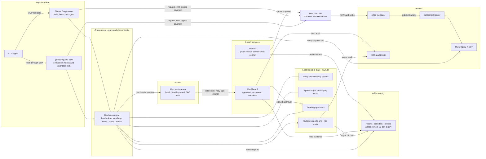
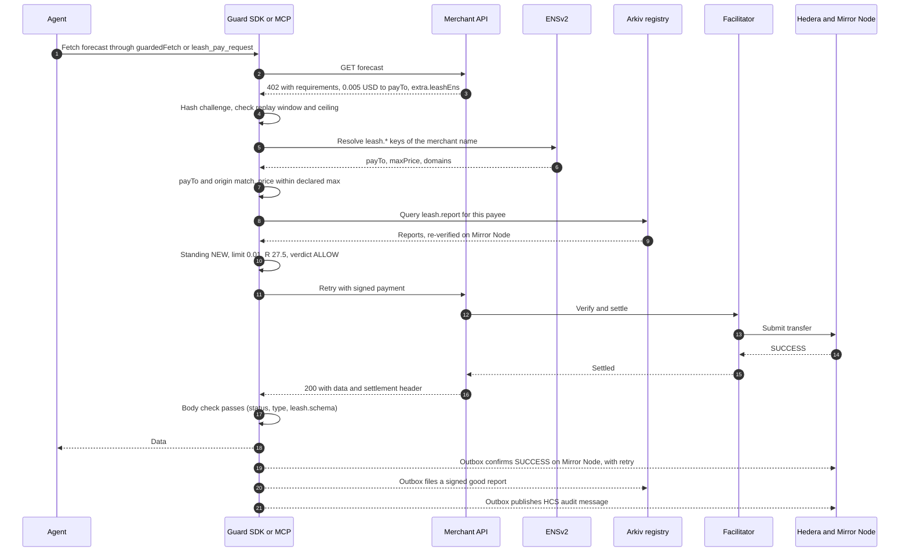
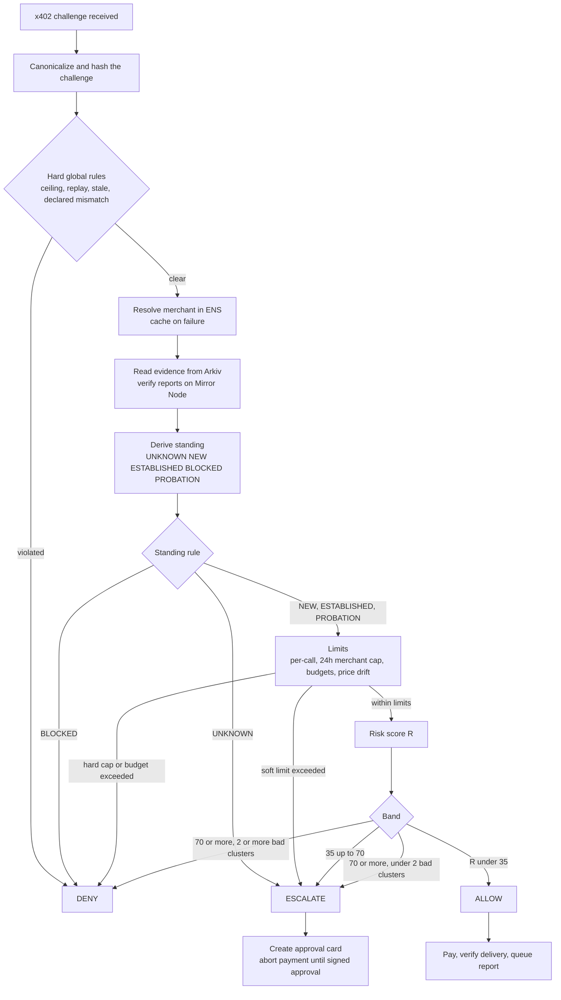
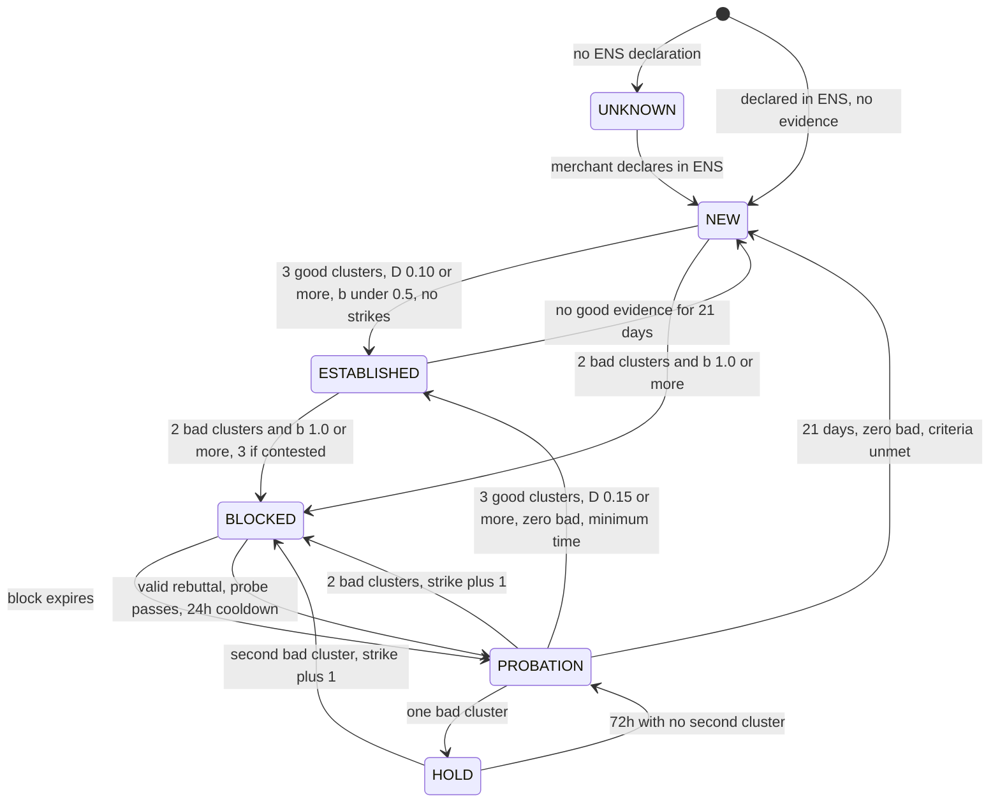

<div align="center">

# Leash

**A payment guard and shared merchant registry for AI agents that pay over x402.**

Before an agent signs a payment, Leash checks who it is paying, what other agents have proven about them, and whether the amount fits the owner's limits. One agent's bad experience protects every other agent.

[](https://leash-explorer.vercel.app)
[](#hedera-settlement-and-audit)
[](#arkiv-the-shared-registry)
[](#ensv2-merchant-identity-and-policy)
[](LICENSE)

[**Quick guide**](https://app.trupeer.ai/view/cENkVXWeo/leash-x-402-payment-guard) · [**Explorer**](https://leash-explorer.vercel.app/explorer) · [**Partner tracks**](https://leash-explorer.vercel.app/tracks) · [**Docs**](https://leash-explorer.vercel.app/docs) · [**Integrate**](https://leash-explorer.vercel.app/integrate)

*Built at ETHGlobal Mumbai 2026.*

</div>

---

## Quick guide

New to Leash? Start with the **[step-by-step guide to your first experience with Leash](https://app.trupeer.ai/view/cENkVXWeo/leash-x-402-payment-guard)**.

## Contents

- [The problem](#the-problem)
- [How Leash works](#how-leash-works)
- [Try it in a minute](#try-it-in-a-minute)
- [Proof on public networks](#proof-on-public-networks)
- [Built on Hedera, Arkiv and ENSv2](#built-on-hedera-arkiv-and-ensv2)
- [Sponsor tracks](#sponsor-tracks)
- [Architecture](#architecture)
- [Getting started](#getting-started)
- [Integrate Leash](#integrate-leash)
- [Testing](#testing)
- [Repository layout](#repository-layout)
- [Configuration: the demo clock](#configuration-the-demo-clock)
- [Changes from PRD v2.1](#changes-from-prd-v21)
- [Disclosures](#disclosures)
- [License](#license)

---

## The problem

x402 lets an AI agent pay for an API inside an ordinary HTTP request: the server answers `402 Payment Required`, the agent signs, and the data comes back. There is no checkout, signup or human. That also means:

- **A merchant can take the money and return junk.** Payment is not delivery.
- **A fake can claim a real merchant's name** and ask to be paid at its own account.
- **Every agent learns this alone, after it has paid.** Agent reputation exists. Nothing checks the *merchant* before the agent pays.

## How Leash works

Every payment gets one of three verdicts **before anything is signed**:

| Verdict | Meaning | Typical cause |
| --- | --- | --- |
| **ALLOW** | Pay now, with no human | Known merchant, amount within limits, low risk score |
| **ESCALATE** | Stop and ask the owner | Unknown merchant, amount above a limit, medium score, probation, an outage |
| **DENY** | Never pay this challenge | Blocked merchant, spoofed identity, replay, price above the declared maximum |

To decide, the guard:

1. **Identifies the payee through ENSv2.** It reads the merchant's own payment declaration (`payTo`, domains, maximum price, response schema) and denies any challenge that contradicts it.
2. **Reads proven history from Arkiv.** It reads the reports other agents filed, and re-verifies each against its real payment on Hedera Mirror Node.
3. **Applies the owner's spending controls.** These are session and daily budgets, per-merchant caps, a per-call ceiling, and owner approval above limits.
4. **Pays, checks delivery and reports.** After a paid call it checks the response against the declared schema, files a signed report to Arkiv, and logs the decision to an HCS topic.

**What makes it different**

- **Shared:** one registry for every agent. When one agent gets burned, the next is protected before it pays.
- **Proof-backed:** a report counts only if it cites a real, settled payment and is signed by the payer's key. Fake reports cost real money, and still fail verification.
- **Forgiving:** no verdict is permanent. Evidence expires on its own, a blocked merchant can file a rebuttal, and a paid probe and probation let it earn trust back.
- **Owner in control:** approvals are signed by the owner's wallet, single-use, bound to one exact challenge, and expire after 2 minutes. The MCP server has no approve tool, so the AI cannot approve itself.

## Try it in a minute

| | |
| --- | --- |
| **Merchant explorer** | https://leash-explorer.vercel.app/explorer reads ENSv2, Arkiv and Mirror Node live, with no key or wallet |
| **Partner tracks** | https://leash-explorer.vercel.app/tracks has each sponsor track's checklist, with live proof: payments, HCS messages, Arkiv writes and queries, ENS records and roles |
| **Integration guide** | https://leash-explorer.vercel.app/integrate has the SDK code and MCP config for Claude Desktop and Claude Code |

The explorer opens on **`mumbai-prod`**, which runs the production policy and keeps evidence for 60 days. There:

- `leash-lemon.eth` is **Blocked** until Nov 11, by two agents' verified bad reports.
- `leash-weather.eth` is **Good**.
- `leash-invoice.eth` is **Excellent**.

The registry menu also offers **`mumbai-1`**, the demo registry, whose entities expire 18 minutes after a run.

**Query the registry yourself.** No key or wallet is needed:

```bash
npx tsx apps/demo/src/arkiv-query.ts mumbai-prod 0.0.11323813
```

Or with nothing installed, straight to Arkiv's public RPC. This returns the reports filed against the weather merchant, newest first:

```bash
curl -s https://rpc.rabdi.db-chain.testnet.arkiv.network -H 'content-type: application/json' --data @- <<'EOF'
{"jsonrpc":"2.0","id":1,"method":"arkiv_query","params":["arkiv.schema = str('leash.report') AND ns = str('mumbai-prod') AND payee = str('0.0.11323813') ORDER BY consensusTs:u64 DESC",{"select":{"key":true,"owner":true,"creator":true,"expiresAt":true,"attributes":{"outcome":true,"txId":true,"payer":true}},"limit":"0x64"}]}
EOF
```

## Proof on public networks

Every link below is a real testnet event. The first lemon payment and the probe payment come from a rehearsal, and are replaced after the final run.

| Event | Hedera transaction ID | Link |
| --- | --- | --- |
| Good payment, with no human (production profile) | `0.0.7162784@1793896157.209108345` | [HashScan](https://hashscan.io/testnet/transaction/0.0.7162784-1793896157-209108345) |
| Payment to lemon, which then delivered junk | `0.0.7162784@1793896231.823642241` | [HashScan](https://hashscan.io/testnet/transaction/0.0.7162784-1793896231-823642241) |
| Two agents' payments to lemon, which delivered junk. Their bad reports block lemon in `mumbai-prod` | `0.0.7162784@1793932584.042346265`<br/>`0.0.7162784@1793932587.359527068` | [HashScan](https://hashscan.io/testnet/transaction/0.0.7162784-1793932584-042346265) · [HashScan](https://hashscan.io/testnet/transaction/0.0.7162784-1793932587-359527068) |
| Two agents pay the invoicing merchant, which delivers. Their good reports are in `mumbai-prod` | `0.0.7162784@1793982862.774261681`<br/>`0.0.7162784@1793982891.724302854` | [HashScan](https://hashscan.io/testnet/transaction/0.0.7162784-1793982862-774261681) · [HashScan](https://hashscan.io/testnet/transaction/0.0.7162784-1793982891-724302854) |
| Probe payment after a rebuttal | `0.0.7162784@1793896292.479701920` | [HashScan](https://hashscan.io/testnet/transaction/0.0.7162784-1793896292-479701920) |
| An MCP tool call that paid with no human (`pnpm mcp:live`) | `0.0.7162784@1793928541.149077514` | [HashScan](https://hashscan.io/testnet/transaction/0.0.7162784-1793928541-149077514) |
| An escalated payment, paid once the owner's signature approved it | `0.0.7162784@1793928699.604292744` | [HashScan](https://hashscan.io/testnet/transaction/0.0.7162784-1793928699-604292744) |
| HCS audit topic `0.0.11326849`: every decision, report, approval, probe and rebuttal (700+ messages) | | [HashScan](https://hashscan.io/testnet/topic/0.0.11326849) |

The transaction ID's account, `0.0.7162784`, is the Blocky402 facilitator, which pays the network fee. The USDC moves from the agent's account to the merchant's, as each HashScan page shows.

### The merchants

All five are real x402 servers on their own origins, run by the team. Lemon and spoof misbehave on purpose, and we disclose that.

| Merchant | ENS name | payTo | Behaviour | Expected verdict |
| --- | --- | --- | --- | --- |
| [weather](https://leash-merchant-weather.vercel.app) | `leash-weather.eth` | `0.0.11323813` | Honest forecast API | ALLOW |
| [invoice](https://leash-merchant-invoice.vercel.app) | `leash-invoice.eth` | `0.0.11342220` | Honest invoicing API: `/invoice`, `/tax`, `/batch` | ALLOW |
| [lemon](https://leash-merchant-lemon.vercel.app) | `leash-lemon.eth` | `0.0.11323814` | Takes the payment, returns junk | Blocked after two agents prove it |
| [spoof](https://leash-merchant-spoof.vercel.app) | claims `leash-weather.eth` | `0.0.11323815` | Impersonates weather with its own account | DENY `declared-mismatch` |
| [rogue](https://leash-merchant-rogue.vercel.app) | none | `0.0.11323818` | No identity at all | ESCALATE `unknown-merchant` |

### List your own merchant

Any merchant with an ENSv2 name on Sepolia can join the registry from the explorer's **[Create merchant](https://leash-explorer.vercel.app/explorer/new)** page:

1. **Prove control.** Connect the wallet that holds `ROLE_SET_TEXT` on the name's Permissioned Resolver. The page checks the role live.
2. **Policy.** Upload a policy file, or fill in `payTo`, max price, domains, probe URL and response fields. Network and asset are fixed to Hedera testnet USDC.
3. **Publish.** One transaction from your wallet writes the `leash.*` records to your own resolver.
4. **Sign and list.** Your wallet signs the policy as it stands on ENS. Leash checks the signature and the role. If you declared a probe URL, it also checks that an unpaid request gets a 402 that claims your name and asks your declared account, network and asset, within your max price. Then its registrar writes a [`leash.merchant`](arkiv/schema.md#leashmerchant) entity to Arkiv.

A listing earns no trust by itself. The merchant starts as NEW, under the new-merchant budgets, and only verified deliveries raise its health. ENS keeps the last word: the explorer drops a listing whose name no longer declares that payee.

## Built on Hedera, Arkiv and ENSv2

Each network does the one job it is best at. Payments and the audit trail are on **Hedera**, shared evidence is on **Arkiv**, and merchant identity and policy are on **ENSv2**.

### Hedera: settlement and audit

- **x402 settlement in USDC.** Merchants settle through the **Blocky402** facilitator, which Hedera's docs list. Its `GET /supported` returns `{"scheme":"exact","network":"hedera:testnet","extra":{"feePayer":"0.0.7162784"}}`. That doesn't list assets, so the guard pins USDC `0.0.429274` (HTS) and denies anything else as `unsupported-asset`.
- **Mirror Node as the verification layer.** No report counts until Mirror Node confirms the payment succeeded, in that token, with that payer, payee and amount, and the payer's key signed the report.
- **HCS as a tamper-evident audit log.** Every decision, report, approval, probe and rebuttal is published to topic [`0.0.11326849`](https://hashscan.io/testnet/topic/0.0.11326849).
- **Spending controls before signing.** These are a $1 per-call ceiling, a $2 session budget, a $10 daily budget, and $0.10 a day across new merchants. Per-merchant caps are $0.05 for NEW, $1 for ESTABLISHED and $0.10 for PROBATION, with a hard cap at 5×. Owner approval is required above any of these.

### Arkiv: the shared registry

Reports, probes and rebuttals are Arkiv entities on the Rabdi testnet, written with `@arkiv-network/sdk`. Each is **owned by the wallet that paid**, and **expires on its own**: after 60 days in production, or 18 minutes on the demo clock. Expiry is the forgiveness model. Reads need no key. The public explorer holds a single one, the registrar's, which can write merchant listings and nothing else. The submission files are in [`arkiv/`](arkiv/): [schema](arkiv/schema.md), [friction](arkiv/friction.md), [reach](arkiv/reach.md), [why Arkiv](arkiv/why-arkiv.md) and [how we use it](arkiv/how-you-use-arkiv.md).

**Writer wallets**

| Wallet | Hedera account | Arkiv owner |
| --- | --- | --- |
| Agent A | `0.0.11323807` | `0x7f0dae584D0ad92150c98f9bE046f393b85A2aAB` |
| Agent B | `0.0.11323809` | `0x01312fA81A82b2a254f77f0eF0e8Ee4Bfc4b5D2C` |
| Agent C | `0.0.11323811` | `0xAC7685aa37b232dA98623F657838453333693983` |
| Prober | `0.0.11323812` | `0x0C8e8B9f0B9d5ddE7f3939e97094f6FA16793674` |
| Funder 1, standing in for agent A | `0.0.11231351` | `0xd490Ac8EF3Ff4C10DF13a5da7125c7E9bA9F70C8` |
| Funder 2, standing in for agent B | `0.0.11231593` | `0xff65B8e047B772e52360A855A85Ac8A377Bfb7F0` |
| Registrar, merchant listings only | none | `0x07cb5E23E542454b469A19C8E0A529177f42Bec1` |

These seven wallets wrote every Leash entity. The two funders write reports when they stand in for agents A and B, in rehearsals and the filmed run, because new wallets count at half weight for their first 24 hours. The guards have filed more than 150 reports, each logged on the audit topic with its Arkiv entity key. The failure tests also wrote deliberate flood and forged rows from agent B's wallet, in `rehearsal-*` namespaces.

### ENSv2: merchant identity and policy

Each merchant declares how it wants to be paid in its own **Permissioned Resolver**, and the guard reads that declaration live before every payment. Names and records are never hard-coded in the guard.

| Name | Registered | Permissioned Resolver | Role |
| --- | --- | --- | --- |
| `leash-weather.eth` | [tx](https://sepolia.etherscan.io/tx/0xfb221a6208ae20faf5b6730dc08acfeac71b2f6bad80715aaff814ce36bf0427) | [`0x27B85f92dF5975ABda37fFD14F0ad56b87BC00F2`](https://sepolia.etherscan.io/address/0x27B85f92dF5975ABda37fFD14F0ad56b87BC00F2) | Honest merchant |
| `leash-lemon.eth` | [tx](https://sepolia.etherscan.io/tx/0xc5ff82de88f34612b4117b3dbd04461e43933e3ef45c288128296e3632887981) | [`0x7f77622E13638dEd82B78C277d2B825d37E50300`](https://sepolia.etherscan.io/address/0x7f77622E13638dEd82B78C277d2B825d37E50300) | Takes payment and returns junk, on purpose |
| `leash-invoice.eth` | [tx](https://sepolia.etherscan.io/tx/0x74588838f89828e84536f2775b21275e2c90eb63efde8a6e01531577a97ec115) | [`0x530DD7A1E3671291a70212e98DF5318713098456`](https://sepolia.etherscan.io/address/0x530DD7A1E3671291a70212e98DF5318713098456) | Honest invoicing API, schema `invoiceId,total,currency` |

**ENSv2 features we use**, all on ENS's own Sepolia deployments:

| Feature | How Leash uses it |
| --- | --- |
| `ETHRegistrar` `0xf633e7fc17e2bbe0d0965d18ec1821dcb754a3d3` | Registers each merchant's `.eth` name |
| A **Permissioned Resolver** per name, deployed through `VerifiableFactory` from `PermissionedResolverImpl` | Holds the merchant's payment declaration in `leash.*` text records: `payTo`, `network`, `asset`, `maxPrice`, `domains`, `schema`, `probeUrl` and `policyVersion`. A spoofed payTo, a foreign domain or a price above `leash.maxPrice` is denied. One resolver per merchant means a role on it covers only that merchant |
| **Enhanced Access Control**, scoped to one text key | `0xa51B1B8EC0608FA2DafEC4E3D5D67a7348C0B5d7` holds `ROLE_SET_TEXT` for the `leash.rebuttal` key only. It can file a rebuttal, but cannot set `leash.payTo` or `leash.maxPrice`. Readers accept a rebuttal only if its signer holds that role |
| **Universal Resolver** `0xeEeEEEeE14D718C2B47D9923Deab1335E144EeEe` | Every lookup goes through it, so the guard has no resolver address built in |

You can check the role yourself. On `0x7f77622E13638dEd82B78C277d2B825d37E50300`, `hasRoles(uint256(keccak256("leash.rebuttal")), 16, 0xa51B…B5d7)` returns true, and the same call with `leash.payTo` returns false. The [Partner tracks](https://leash-explorer.vercel.app/tracks#ens) page runs these checks live.

## Sponsor tracks

The [Partner tracks page](https://leash-explorer.vercel.app/tracks) shows the same checklist with live evidence.

| Track | Requirement | Where it is met |
| --- | --- | --- |
| **Hedera x402** | An x402 endpoint that settles on Hedera testnet through a listed facilitator | The merchants in `apps/merchant` settle USDC through Blocky402. See [the proof table](#proof-on-public-networks) |
| | An agent that completes a paid request with no human | Agent A through the SDK, and agent C through the MCP server, in the proof table |
| | README covering setup, architecture and payment flow, with a settled transaction ID | [Getting started](#getting-started), [Architecture](#architecture) with the [payment flow](#payment-flow), and the proof table |
| | Demo video showing a payment settle, with its HashScan page | In the ETHGlobal submission |
| | Extra points | Spending controls enforced before signing, HCS topic `0.0.11326849` as the audit log, and settlement in the HTS token USDC `0.0.429274` |
| **Arkiv** | Writes to the current testnet with `@arkiv-network/sdk`, and a feature users see reads it | Reports, probes and rebuttals on Rabdi. Every guard decision and the explorer's health bars read them |
| | Writer wallets and a query to run | [Writer wallets](#arkiv-the-shared-registry) and the [`curl` query](#try-it-in-a-minute) |
| | `arkiv/schema.md`, `arkiv/friction.md` and one file per judging criterion | [`arkiv/`](arkiv/) |
| | Open-source licence, and how AI was used | MIT, and [Disclosures](#disclosures) |
| **ENSv2** | Built on ENSv2 on Sepolia, central to the product | Every payment is checked against the merchant's ENSv2 declaration, and rebuttals rest on a key-scoped Enhanced Access Control role |
| | A functional live demo, not hard-coded | https://leash-explorer.vercel.app reads ENS, Arkiv and Mirror Node live |

## Architecture



### Payment flow

The happy path: an agent buys a forecast from a declared merchant, with no human involved.



### Decision pipeline

Runs before anything is signed.



<details>
<summary><b>Merchant standing</b>: a block always ends in probation</summary>



</details>

## Getting started

**Requirements:** Node 22.13 or later, and pnpm.

```bash
pnpm install
pnpm test                 # engine, guard and MCP tests; no network
cp .env.example .env      # fill in the funders, Arkiv key and Sepolia wallets
pnpm wallets:create       # real testnet accounts for agents, prober and merchants
pnpm wallets:fund         # after claiming test USDC at faucet.circle.com
pnpm wallets:check        # readiness report, prints no secrets
pnpm hcs:create           # the HCS audit topic
pnpm ens:setup            # real ENSv2 names, resolvers, records and roles on Sepolia
```

Then, each in its own terminal:

```bash
pnpm --filter @leash/dashboard dev          # the site on :3100; the owner console is /console
npx tsx apps/demo/src/show.ts all          # the demo scenes, in the filmed order
```

One paid call from the command line:

```bash
npx tsx apps/demo/src/agent.ts A "https://leash-merchant-invoice.vercel.app/invoice?customer=Acme&qty=3&unitPrice=200"
```

<details>
<summary>More demo options</summary>

- **The prober** also runs alone, with `npx tsx apps/demo/src/prober.ts`. Leave it off during the show: scene 5a runs its own probe, and an extra probe when lemon enters probation would fail and start a hold early. That is correct behaviour, but out of order for the demo.
- **Scene 7** (Arkiv outage): start the show with `SHOW_RELAY=1 ARKIV_RPC_URL=http://127.0.0.1:8765`, so Arkiv traffic passes through the relay it cuts.
- **Merchants locally:** `pnpm merchants` runs all five merchants on ports 4801 to 4805.

</details>

## Integrate Leash

### SDK

```ts
import { x402Client } from "@x402/core/client";
import { wrapFetchWithPayment } from "@x402/fetch";
import { createLeashGuard } from "@leash/guard";

const guard = createLeashGuard({ agent, hederaAccount, hederaKey, ownerAddress, arkivAccessKey, namespace: "mumbai-1" });
const client = new x402Client(); // register your Hedera scheme here
guard.attach(client);
const paidFetch = guard.guardedFetch(wrapFetchWithPayment(fetch, client));
```

> [!NOTE]
> A developer can still call the raw client, so the SDK does not prevent bypass. The MCP server does.
>
> A default `x402Client` has its own spend controls, which reject some challenges before the guard sees them. No payment is made, but that challenge gets no decision or audit message. `rawClient` from `@leash/guard` turns them off, so the guard decides everything.

### MCP server

The server holds the signer, and there is no approve tool:

```json
{
  "mcpServers": {
    "leash": {
      "command": "pnpm",
      "args": ["--dir", "/path/to/Leash", "exec", "tsx", "packages/mcp/src/server.ts"],
      "env": { "LEASH_MCP_AGENT": "C" }
    }
  }
}
```

`pnpm --dir` starts the server in the repo, so it finds `.env` and shares the console's database, and an approval signed there reaches it. On Windows, use `"command": "cmd"` with `"/c", "pnpm"` at the start of `args`. The site's [`/integrate`](https://leash-explorer.vercel.app/integrate) page has this config and the Claude Code command.

## Testing

| Command | What it covers |
| --- | --- |
| `pnpm test` | Unit and contract tests for the engine, guard, MCP server, merchants and prober. No network. CI runs them on Linux, macOS and Windows with Node 22.13.0 and 24 |
| `pnpm mcp:live` | Tests the MCP server the way Claude Desktop runs it: it starts the server over stdio from outside the repo, calls all seven tools against the live merchants, Hedera testnet, Arkiv and ENS, then checks each payment on Mirror Node, each report on Arkiv and each decision on the HCS topic. Spends about $0.10 of test USDC |
| `apps/demo/src/failures.ts` | Causes failure modes F1 to F15 for real and checks each one (see below) |
| `npx tsx apps/demo/src/latency.ts` | Measures the latency the guard adds, cold and warm, on the real networks. Dry runs only, so nothing is paid or written |

`failures.ts` runs in three parts: `local`, `lemon` and `weather`. Run it as `LEASH_NAMESPACE=rehearsal-<name> npx tsx apps/demo/src/failures.ts <part>`, and give `lemon` the setting `LEASH_LIVE_BLOCK_SEC=120,240,600` so its checks fit inside the blocks. It makes real payments and writes test evidence, so it refuses any namespace that is not `rehearsal-*`. Some faults can't be triggered on a public merchant. For those it starts real servers on this machine: a facilitator that fails to settle, a merchant at a blocked payTo with no ENS name, a 402 made of instructions, and relays it really cuts.

In `pnpm mcp:live`, the owner's side goes through the console's approval API with a throwaway owner key, in its own namespace and off the audit topic. Local state goes into throwaway databases.

## Repository layout

| Path | What |
| --- | --- |
| [`packages/core`](packages/core) | Pure decision engine: score, standing replay, limits, decide. No I/O, takes `now` |
| [`packages/guard`](packages/guard) | SDK, ENS, Arkiv and Mirror Node adapters, SQLite store, outbox |
| [`packages/mcp`](packages/mcp) | MCP server over stdio, plus the live test suite |
| [`apps/merchant`](apps/merchant) | The five x402 merchants: one codebase, one deployment each |
| [`apps/dashboard`](apps/dashboard) | Owner console, public explorer, Partner tracks page, docs and live demo |
| [`apps/demo`](apps/demo) | Agents, prober, scene runner, failure tests and setup scripts |
| [`arkiv/`](arkiv) | Arkiv submission files |

## Configuration: the demo clock

`LEASH_POLICY_PROFILE=live` runs the same engine on real elapsed time, with shorter durations. Two settings in `.env` control it, and the banner on the console and explorer always shows the values in use.

| Setting | Default | Meaning |
| --- | --- | --- |
| `LEASH_LIVE_BLOCK_SEC` | `60,120,300` | Block length in seconds at strike 1, 2 and 3. Later strikes use the last value |
| `LEASH_LIVE_DAY_SEC` | `18` | Real seconds in one policy day. Sets the hold (3 days), rebuttal cooldown (1 day) and probation minimum (3 days) |

- **What it refuses:** a value that is not a positive number, blocks that shrink, or a first block no longer than one policy day. The guard stops at startup rather than run on a broken clock.
- **Evidence expiry:** 60 policy days, or twice the total of the blocks if that is longer, so a block's reports can never expire before the block does.
- **Keep readers in step:** each reader works out standing for itself, so set the same values on the explorer's Vercel project and redeploy it.
- **Scene timing:** the rebuttal scene takes about 30 seconds and must land during the first block, so keep the first block at 45 seconds or more for the full show.
- **Production:** these settings have no effect. `LEASH_POLICY_PROFILE=production` always uses the PRD's durations.

## Changes from PRD v2.1

The PRD asks for any rule it does not contain to be recorded here, with a reason.

<details>
<summary><b>26 recorded changes</b> (click to expand)</summary>

| Change | Reason |
| --- | --- |
| New DENY reason `unsupported-asset`: only the configured USDC token is payable | A challenge in another token has no USD value to score |
| New ESCALATE reason `unknown-origin` | A call that bypasses `guardedFetch` has no real origin to check against ENS |
| The G5 per-payee window is a live-profile duration (18 s) | Otherwise agent A's second bad report in scene 6 would be ignored |
| Evidence scope stays at probation entry after probation ends | In the live profile, decay is not shortened, so evidence from before a block could trigger another |
| `stale-challenge` uses the time this request received its 402 | A fresh 402 for the same price has the same hash, so a first-seen time could never clear |
| Live blocks default to 1, 2 and 5 minutes rather than 90, 180 and 360 seconds, and are set in `.env` | Chosen by the team for demo pacing. The block length per strike is now a list, and production's list is the PRD's 5, 10 and 20 days |
| The filmed order runs the rebuttal straight after scene 2 | With a 1-minute block it has to land while the block is still on |
| The SDK config is `ownerAddress`, `hederaAccount`, `hederaKey`, `limits.replayWindowSec`, not the PRD's `owner.address` and `replayWindowSec`. `network` and `unknownMerchantPolicy` are fixed, so they are not settings | The guard signs reports with the payer's key, so it needs that key. `unknownMerchantPolicy` is fixed in v2 anyway |
| `leash_pay_request` also returns `no_payment` and `unconfirmed` | "Paid" must mean paid. A page that asks for no payment, or a merchant that failed after payment, returns no body, because the PRD allows a body only on a successfully paid call |
| Any evidence the reader cannot check escalates as `unverified-reports`, not only two or more unverified bad clusters | NFR-03. One bad report on a NEW merchant escalates with full information (S4), so ignoring it during a Mirror outage would be a false ALLOW. It still never denies |
| New DENY reason `malformed-challenge`: a payTo that is not a plain account id, or an amount that is not a whole number | NFR-05: text from a 402 never reaches a result, card or log. A checksum or alias payTo would also make every report against it unverifiable, since Mirror Node names the numeric id |
| The reader takes the latest 200 reports that verify, reading past rows that do not, up to 1,000 rows. Past that the read is incomplete, so the guard escalates. Future-dated rows are not fetched | F15. Anyone can write rows, so a flood newer than the real reports would hide them. Shown live: under a 210-row flood, the newest 200 rows held none of a twice-blocked merchant's 8 real rows |
| A probe counts only if an allow-listed prober created it (Arkiv `$creator`), not merely owns it | F13. An entity's owner can hand it to any address, so a merchant's side could pass off a forged passing probe as the prober's. Checked on live rows: a forged "pass" probe backed by a real payment, handed to the prober's address, passes an owner check and fails the creator check |
| New ESCALATE reason `settlement-unknown` | Section 12 says an unknown settlement outcome escalates, but names no code |
| New DENY reason `locally-blocked` | "Reject and block locally" needs a reason, and the PRD gives none |
| An amount above `leash.maxPrice` on a stale declaration escalates, as `declared-stale-mismatch` | A stale record may be out of date, and section 12 says a stale declaration never denies |
| A rebuttal must come from a name whose ENS declaration lists that payee | Without this, anyone could use their own name to burn another merchant's one rebuttal |
| The report column `domain` is indexed, and ENS decides which rows to believe | Needed to search by domain. The report signature does not cover the domain, so a row alone proves nothing |
| A block compares b after G4 halving | G4 says a contested merchant takes half weight, so three dust reports should not block it |
| Promotion to ESTABLISHED is also judged at the moment its waiting period ends | Evidence decays, so otherwise a merchant that earned its standing would lose it just by being read late |
| A `leash.policyVersion` bump takes effect at the next 60-second refresh | Reading the version on every decision would add a network call to each payment |
| `leash_report_outcome` has no `note` field | Free text from an LLM or merchant has no place in a shared registry |
| The agents' x402 client has its own spend controls off | They reject a challenge before any hook runs, which would leave it with no decision, reason or audit. The guard applies the same rules |
| Signed receipts, family taint and the Swarm bonus are not built | FR-23 is "could", and the PRD says the simulation showed taint changed nothing |
| Merchant facilitator failover is a redeploy, not automatic | Two facilitators made the advertised `feePayer` vary by deployment, which is part of the signed payment |
| Rebuttals expire with reports (60 days), not at 30 days | A rebuttal only matters while the block it refers to is in evidence |

</details>

## Disclosures

- **AI use:** we used Claude Code throughout, in a spec-driven workflow.
  - *Where:* it reviewed the team's PRD and revised it into v2.1, planned the build in `BUILD_PLAN.md`, and wrote most of the code, tests and docs in every package, one iteration at a time.
  - *How:* the team decided what to build and in what order. It supplied the funder, Arkiv and ENS keys and the test funds, and made the product decisions Claude Code raised. It reviewed each iteration's report and made every commit by hand.
  - *Spec files:* `Leash PRDv2.1.md` and `BUILD_PLAN.md`, in the repo.
- **Timeline:** hacking started at 13:00 IST on Nov 5, 2026. `Leash PRDv2.1.md` was revised from the team's PRD v2.0, dated Nov 3, between 10:43 and 11:22 IST that morning, before hacking began. It is planning material only. The build started at 14:55 IST, and no code predates it. Rules changed during the build are recorded in [Changes from PRD v2.1](#changes-from-prd-v21).
- **Commit history:** the build was first committed in 11 commits between 15:03 and 21:03 IST on Nov 5. At 21:11 IST the team had them squashed into the first commit, `1744b3b`, and the earlier commits no longer exist. Later commits are dated as they happen.
- **Testnets:** Hedera testnet, Arkiv testnet and ENSv2 on Sepolia, with test tokens. ENS's Sepolia registrar charges fees in its own test token, named `MockUSDC`. We deploy no mock contracts.
- **Merchants:** all five merchants are run by the team. Lemon and spoof misbehave on purpose, to show what the guard catches.
- **Live profile:** the demo uses a disclosed policy profile, by default 1 policy day = 18 real seconds with blocks of 1, 2 and 5 minutes. The screen always shows the values in use. See [`arkiv/friction.md`](arkiv/friction.md).

## License

[MIT](LICENSE)
