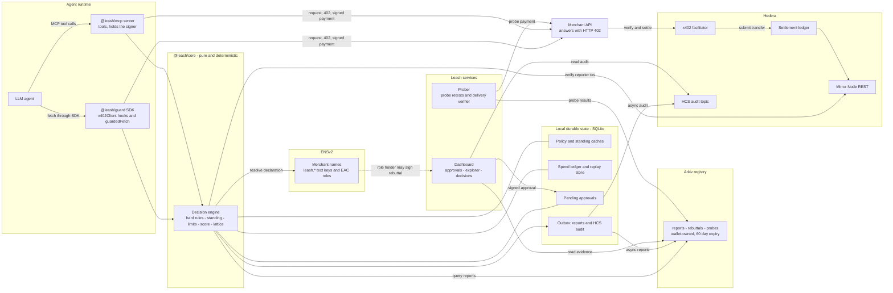
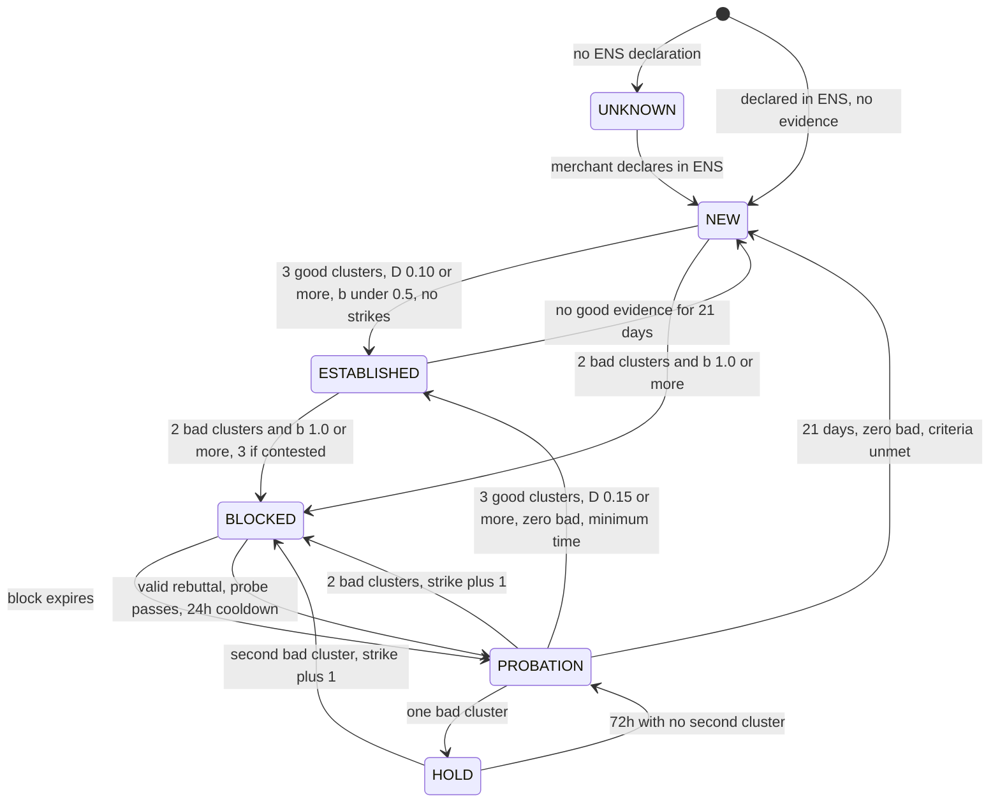
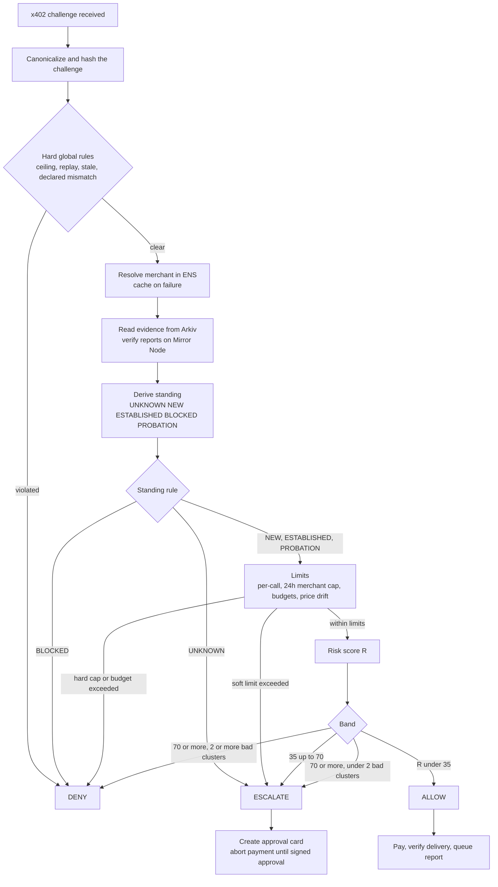
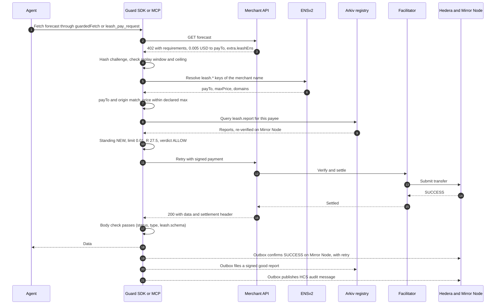

# Leash

A shared, proof-of-payment-backed payee-safety registry and guard for AI agents paying over x402. One agent's loss protects every other agent, no verdict is permanent, and a merchant coming out of a block earns trust back through probation.

An agent's payment gets one of three verdicts before anything is signed:

| Verdict | Meaning | Typical cause |
| --- | --- | --- |
| ALLOW | Pay now | Known merchant, amount within limit, low score |
| ESCALATE | Stop and ask the owner | Unknown merchant, amount above limit, medium score, probation, outage |
| DENY | Never pay this challenge | Blocked merchant, spoof, replay, over declared price |

**How it works:** the guard identifies the payee through ENSv2, reads proven history from Arkiv, re-verifies every report against Hedera Mirror Node, decides, and files a signed report after each paid call.

## Try it

**Public explorer:** https://leash-explorer.vercel.app/explorer

It reads ENSv2, Arkiv and Hedera Mirror Node directly, and holds no keys or database. The registry menu switches between the demo registry (live profile, entities expire in 18 minutes) and `mumbai-prod` (production profile, 60-day expiry).

**Query the registry yourself**, with no key or wallet:

```bash
npx tsx apps/demo/src/arkiv-query.ts mumbai-prod 0.0.11323813
```

## Proof on public networks

Every link is a real testnet event. The lemon and probe payments come from a rehearsal, and are replaced after the final run.

| Event | Link |
| --- | --- |
| Good payment, with no human (production profile) | [HashScan](https://hashscan.io/testnet/transaction/0.0.7162784-1793896157-209108345) |
| Payment to lemon, which then delivered junk | [HashScan](https://hashscan.io/testnet/transaction/0.0.7162784-1793896231-823642241) |
| Probe payment after a rebuttal | [HashScan](https://hashscan.io/testnet/transaction/0.0.7162784-1793896292-479701920) |
| HCS audit topic, with decision and denial messages (`0.0.11326849`, messages 1 and 14) | [HashScan](https://hashscan.io/testnet/topic/0.0.11326849) |

**Hedera x402.** We use the Blocky402 facilitator. Its `GET /supported` returns `{"scheme":"exact","network":"hedera:testnet","extra":{"feePayer":"0.0.7162784"}}`. That output does not list assets: we pin USDC `0.0.429274` in the guard, and DENY anything else as `unsupported-asset`. No report counts until Mirror Node confirms the payment succeeded, in that token, with that payer, payee and amount, and the payer's key has signed it.

**Arkiv writer wallets**

| Wallet | Hedera account | Arkiv owner |
| --- | --- | --- |
| Agent A | `0.0.11323807` | `0x7f0dae584D0ad92150c98f9bE046f393b85A2aAB` |
| Agent B | `0.0.11323809` | `0x01312fA81A82b2a254f77f0eF0e8Ee4Bfc4b5D2C` |
| Agent C | `0.0.11323811` | `0xAC7685aa37b232dA98623F657838453333693983` |
| Prober | `0.0.11323812` | `0x0C8e8B9f0B9d5ddE7f3939e97094f6FA16793674` |

Rehearsals also used the two funder accounts as agents, because new agents count at half weight for their first 24 hours.

**ENSv2 on Sepolia**

| Name | Resolver | Role |
| --- | --- | --- |
| `leash-weather.eth` | `0x27B85f92dF5975ABda37fFD14F0ad56b87BC00F2` | Honest merchant |
| `leash-lemon.eth` | `0x7f77622E13638dEd82B78C277d2B825d37E50300` | Takes payment and returns junk, on purpose |

Each name has `leash.*` text records. `0xa51B1B8EC0608FA2DafEC4E3D5D67a7348C0B5d7` holds `ROLE_SET_TEXT` for only the `leash.rebuttal` key on the lemon resolver, and that role is what lets it file a rebuttal. Names and records are read live and are not hard-coded in the guard. The merchants are run by the team, which we disclose: lemon is a real merchant behaving badly on purpose.

## How it fits together

**Architecture**



**Merchant standing:** a block always ends in probation.



**Decision pipeline**, which runs before anything is signed



**Happy path**



## Run it

Requires Node 22.13 or later and pnpm.

```bash
pnpm install
pnpm test                 # engine, guard and MCP tests; no network
cp .env.example .env      # fill in the funders, Arkiv key and Sepolia wallets
pnpm wallets:create       # real testnet accounts for agents, prober and merchants
pnpm wallets:fund         # after claiming test USDC at faucet.circle.com
pnpm wallets:check        # readiness report, prints no secrets
pnpm hcs:create
pnpm ens:setup            # real ENSv2 names, resolvers, records and roles on Sepolia
```

Then, each in its own terminal:

```bash
pnpm --filter @leash/dashboard dev          # owner console on :3100
npx tsx apps/demo/src/show.ts all          # the demo scenes, in the filmed order
```

The prober also runs alone with `npx tsx apps/demo/src/prober.ts`. Leave it off during the show: scene 5a runs its own probe, and an extra probe on entering probation would fail on lemon and start a hold early, which is correct behaviour but out of order for the demo.

For scene 7, start the show with `SHOW_RELAY=1 ARKIV_RPC_URL=http://127.0.0.1:8765` so Arkiv traffic passes through the relay it cuts.

## Use it

**SDK**

```ts
import { x402Client } from "@x402/core/client";
import { wrapFetchWithPayment } from "@x402/fetch";
import { createLeashGuard } from "@leash/guard";

const guard = createLeashGuard({ agent, hederaAccount, hederaKey, ownerAddress, arkivAccessKey, namespace: "mumbai-1" });
const client = new x402Client(); // register your Hedera scheme here
guard.attach(client);
const paidFetch = guard.guardedFetch(wrapFetchWithPayment(fetch, client));
```

A developer can still call the raw client, so the SDK does not prevent bypass. The MCP server does.

A default `x402Client` has its own spend controls, which reject some challenges before the guard sees them. No payment is made, but that challenge gets no decision or audit message. `rawClient` from `@leash/guard` turns them off so the guard decides everything.

**MCP**, where the server holds the signer and there is no approve tool:

```json
{
  "mcpServers": {
    "leash": {
      "command": "npx",
      "args": ["tsx", "packages/mcp/src/server.ts"],
      "env": { "LEASH_ENV_FILE": ".env", "LEASH_MCP_AGENT": "C" }
    }
  }
}
```

## Repo

| Path | What |
| --- | --- |
| `packages/core` | Pure engine: score, standing replay, limits, decide. No I/O, takes `now` |
| `packages/guard` | SDK, ENS, Arkiv and Mirror adapters, SQLite store, outbox |
| `packages/mcp` | MCP server over stdio |
| `apps/dashboard` | Owner console and public read-only explorer |
| `apps/demo` | Real merchants, prober, scene runner, setup scripts |
| `arkiv/` | Arkiv submission files |

## Changes from PRD v2.1

The PRD asks for any rule it does not contain to be recorded here, with a reason.

| Change | Reason |
| --- | --- |
| New DENY reason `unsupported-asset`: only the configured USDC token is payable | A challenge in another token has no USD value to score |
| New ESCALATE reason `unknown-origin` | A call that bypasses `guardedFetch` has no real origin to check against ENS |
| The G5 per-payee window is a live-profile duration (18 s) | Otherwise agent A's second bad report in scene 6 would be ignored |
| Evidence scope stays at probation entry after probation ends | In the live profile, decay is not shortened, so evidence from before a block could trigger another |
| `stale-challenge` uses the time this request received its 402 | A fresh 402 for the same price has the same hash, so a first-seen time could never clear |
| New ESCALATE reason `settlement-unknown` | Section 12 says an unknown settlement outcome escalates, but names no code |
| New DENY reason `locally-blocked` | "Reject and block locally" needs a reason, and the PRD gives none |
| An amount above `leash.maxPrice` on a stale declaration escalates, as `declared-stale-mismatch` | A stale record may be out of date, and section 12 says a stale declaration never denies |
| A rebuttal must come from a name whose ENS declaration lists that payee | Without this, anyone could use their own name to burn another merchant's one rebuttal |
| The report column `domain` is indexed, and ENS decides which rows to believe | Needed to search by domain. The report signature does not cover the domain, so a row alone proves nothing |
| A block compares b after G4 halving | G4 says a contested merchant takes half weight, so three dust reports should not block it |
| Promotion to ESTABLISHED is also judged at the moment its waiting period ends | Evidence decays, so otherwise a merchant that earned its standing would lose it just by being read late |
| A `leash.policyVersion` bump takes effect at the next 60-second refresh | Reading the version on every decision would add a network call to each payment |
| `leash_report_outcome` has no `note` field | Free text from an LLM or merchant has no place in a shared registry |
| The agents' x402 client has its own spend controls off | They reject a challenge before any hook runs, which would leave it with no decision, reason or audit. The guard applies the same rules |
| Signed receipts, family taint and the Swarm bonus are not built | FR-23 is "could", and the PRD says the simulation showed taint changed nothing |
| Merchant facilitator failover is a redeploy, not automatic | Two facilitators made the advertised `feePayer` vary by deployment, which is part of the signed payment |
| Rebuttals expire with reports (60 days), not at 30 days | A rebuttal only matters while the block it refers to is in evidence |

## Disclosures

- **AI use:** this project was built with Claude Code, which wrote most of the code under the team's direction.
- **Pre-existing work:** `Leash PRDv2.1.md` is planning material written before any code, and is disclosed as such. No code predates 15:03 IST on Nov 5, 2026.
- **Commit history:** the first commit squashes 11 earlier commits made between 15:03 and 21:03 IST on Nov 5, 2026. Later commits are dated as they happen.
- **Testnets:** Hedera testnet, Arkiv testnet and ENSv2 on Sepolia, with test tokens. ENS's Sepolia registrar charges fees in its own test token, named `MockUSDC`. We deploy no mock contracts.
- **Live profile:** the demo uses a disclosed policy profile where 1 policy day = 18 real seconds. See `arkiv/friction.md`.

## License

MIT. See `LICENSE`.
